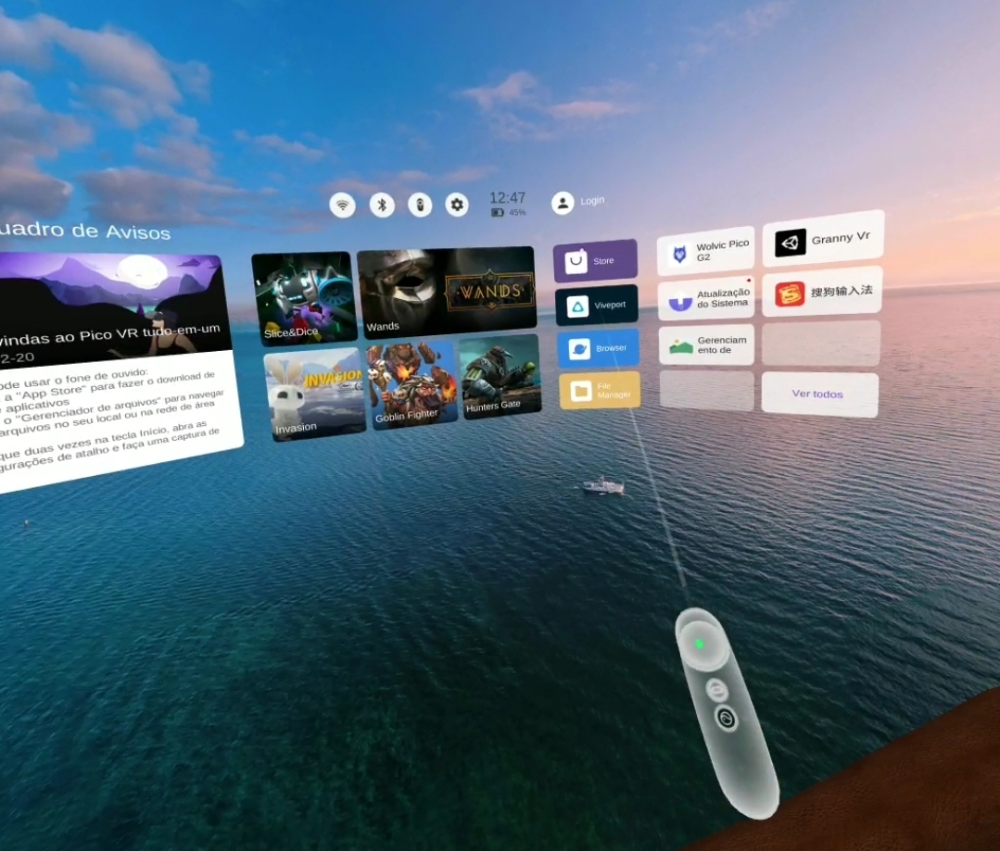

# PicoVerso VR — jogo 3D para Pico G2

Jogo de realidade virtual feito para o **Pico G2** e o controle de 3DoF (estilo Meta Quest): mundos em 360°, personagens 3D que andam e conversam com IA, casas com interior, braços que seguem o controle, sons e música. Tudo roda no navegador, sem instalar nada.

## PICO — imagens de referência

Imagens enviadas pelo usuário para o README do PicoVerso VR, apresentadas separadamente. Mostram o headset, o controle e o menu do sistema PICO; não são capturas do jogo nem comprovação de compatibilidade.

### Headset e controle


### Menu do sistema PICO



## Como jogar

* **Andar:** deslize o **touch de trás** do controle para frente/trás (← → gira em passos de 30°).
* **Clicar:** gatilho ou clique do touch — botões do menu, teclado flutuante, portas, pessoas e estrelas.
* **Menu:** botão lateral do controle, ou o botão **☰ Menu** no painel à sua frente.
* **Objetivo:** encontre as **8 estrelas** de cada mundo (algumas estão dentro das casas — abra a porta e entre!).
* **Conversar:** clique em uma pessoa (ou em **💬 Falar**), digite no teclado flutuante ou toque nas respostas rápidas. O **Pico**, robô do saguão, é a IA geral.

## O que tem

| | |
|---|---|
| Menu | Aba grande e curva estilo navegador (abas, barra de endereço, atalhos), animações, teclado flutuante, tema claro/escuro |
| Mundos | Vila Verde (dia), Oásis do Pôr do Sol (deserto), Vale Nevado (aurora) — céu panorâmico 360°, nuvens, partículas, fonte, moinho, fogueira |
| Personagens | 12 moradores + robô, modelados em 3D, andam pelo mapa, acenam, falam (boca e braços animados) |
| Casas | 6 por mapa, com porta que abre (e bloqueia quando fechada), móveis, janelas acesas e chaminé |
| Braços | Braço em 3D com cotovelo (IK) que aponta para onde o controle aponta, com laser e cursor |
| Som | Efeitos, música generativa por mapa, ambiente (vento, pássaros, sinos) e voz falada das pessoas (síntese do navegador) |
| IA | Conversa em português com memória do seu nome, dicas do jogo, piadas, clima etc. Funciona offline |

## Rodando no Pico G2

O WebXR exige página segura (**HTTPS** ou `localhost`). Opções:

1. **GitHub Pages:** em *Settings → Pages* publique esta branch (pasta raiz). Abra a URL `https://…github.io/…` no navegador do Pico.
2. **Rede local + adb:** no PC, `python3 -m http.server 8000` e `adb reverse tcp:8000 tcp:8000`; no navegador do headset abra `http://localhost:8000`.

Na tela inicial escolha:

* **🥽 Entrar em VR (WebXR)** — recomendado (habilitado se o navegador do headset suportar WebXR).
* **📱 Modo óculos — tela dividida** — plano B: renderiza dois olhos lado a lado e usa o giroscópio. Não corrige a distorção das lentes.
* **🖥️ Jogar na tela** — mouse + teclado (WASD/setas, `M` menu, `Espaço` clique) ou gamepad; ótimo para testar no PC.

### Calibrando o controle

Cada firmware do Pico mapeia os botões de um jeito. No menu vá em **Controle** (🎮): há um teste ao vivo dos eixos/botões e três calibrações — **CLIQUE**, **MENU** e **ANDAR** (toque no botão e depois acione o controle). Sem calibrar, qualquer botão (exceto o 1) clica, o botão 1 abre o menu e o touch anda. Sem controle nenhum, ative **Selecionar com o olhar** em *Ajustes*.

## IA de verdade (opcional)

Por padrão a conversa usa regras locais. Para usar um LLM, publique um endpoint seu (que guarde a chave de API do lado do servidor) que aceite `POST {system, message, player}` e responda `{reply}`, e no navegador execute:

```js
localStorage.pico_ai_url = 'https://seu-servidor/chat'
```

## Estrutura

```
index.html      tela de entrada
lib/three.min.js Three.js r160 (local, funciona offline)
js/audio.js     sons e música sintetizados (WebAudio) + voz
js/brain.js     elenco de personagens e IA de conversa
js/world.js     céus 360°, personagens, casas, mapas, colisão
js/ui.js        painéis 3D, teclado flutuante, telas do menu
js/main.js      renderização, entrada do controle, braços, locomoção
```

> Nota: desenvolvido e testado em Chromium (WebGL, mouse, teclado, gamepad simulado e tela dividida). O caminho WebXR segue a API padrão, mas não foi possível validar em um Pico G2 físico; use a calibração do controle se algum botão se comportar diferente.

## APK e hospedagem (GitHub Actions)

* **APK:** o workflow `Build APK` roda a cada push (ou manualmente em *Actions → Build APK → Run workflow*). Baixe `PicoVerso-apk` em *Artifacts* e instale com `adb install app-debug.apk`. O app é um WebView em tela cheia com o jogo embutido (offline). **WebView não tem WebXR**, então o APK usa o modo *óculos (tela dividida)* ou *tela*.
* **WebXR de verdade:** o workflow `Deploy GitHub Pages` publica o jogo em HTTPS quando algo entra na `main`. Ative em *Settings → Pages → Source: GitHub Actions* e abra a URL no navegador do Pico para usar **Entrar em VR**.

---

## Pulse Saber G2 — jogo de ritmo original

**[Jogar WebXR](https://freestylesjoaoemiguel-max.github.io/GAMES-IN-PICOG2/pulse-saber-g2/)** · **[Baixar APK direto](https://freestylesjoaoemiguel-max.github.io/GAMES-IN-PICOG2/pulse-saber-g2/downloads/Pulse-Saber-G2.apk)** · **[Guia, código e testes](pulse-saber-g2/README.md)**

Um sabre, três músicas originais, nove mapas, modelos externos CC0, combos, bombas, resultados e recordes locais. Jogo independente inspirado no gênero — não Beat Saber nem seu conteúdo comercial. WebXR requer navegador compatível; APK Java/OpenGL monoscópico experimental, **sem runtime PICO ou teste físico no G2**. O PicoVerso permanece intacto na raiz.


---

## Discord VR G2 — novo aplicativo independente

**[Abrir WebXR](https://freestylesjoaoemiguel-max.github.io/GAMES-IN-PICOG2/discord-vr-g2/)** · **[Baixar APK](https://freestylesjoaoemiguel-max.github.io/GAMES-IN-PICOG2/discord-vr-g2/downloads/Discord-VR-G2.apk)** · **[Passo a passo fácil](discord-vr-g2/docs/COMO_USAR.md)**

O PicoVerso VR continua preservado na raiz. Discord VR G2 está em uma subpasta: modo local no Pages, WebXR exige navegador compatível, APK experimental sem validação no G2/runtime PICO. [Código e limites](discord-vr-g2/README.md).
