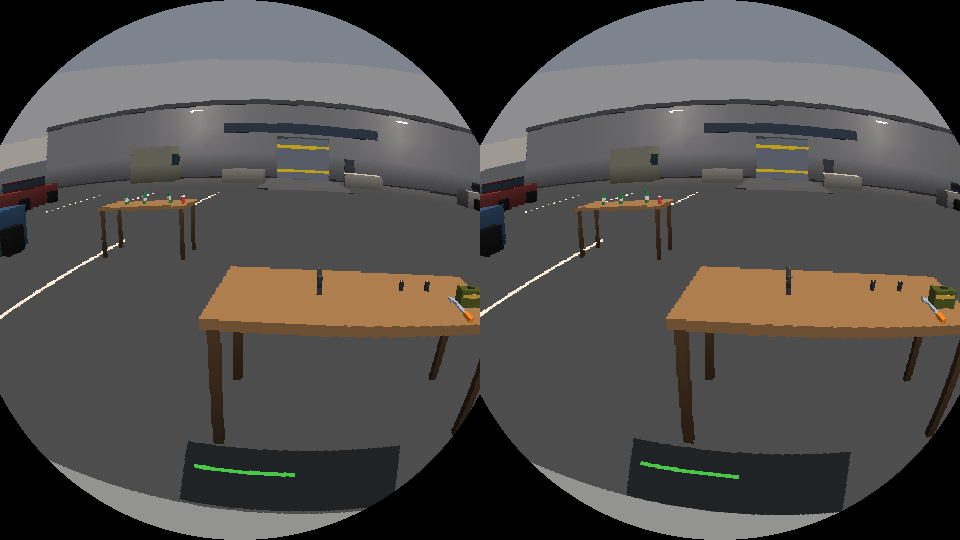
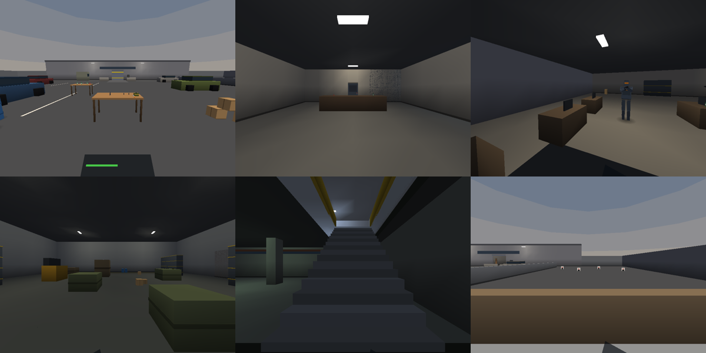

# PICO VR: OPERATION ZERO

FPS VR físico para **Pico G2 / Pico G2 4K**, com identidade própria: o agente entra no
**Complexo Vantor-7**, uma instalação industrial abandonada, para recuperar o *Dispositivo ZERO*.
A interação física (pegar, arremessar, empurrar, recarregar com as mãos) foi inspirada na sensação de
jogos VR físicos, mas **todo o conteúdo é original**: mapa, personagens, armas, modelos, sons e textos
foram criados neste projeto, nada vem de Boneworks/Bonelab ou de outros jogos.

- APK: `PICO-VR-Operation-Zero.apk`
- Pacote: `com.joaolimz.operationzero`
- Versão: `1.0.0` (versionCode 1)
- 100% offline: o APK **não pede permissão de INTERNET**, não usa conta, login, servidor, Google Play
  Services nem a loja Pico. A única permissão é `VIBRATE`.





*Imagens geradas a partir da fila de renderização real do jogo por um rasterizador de teste em CPU
(sem texto/HUD textual e sem a textura de detalhe); não são capturas do headset.*

## Jogos neste repositório

| Jogo | Descrição | APK |
|---|---|---|
| **PICO VR: OPERATION ZERO** | FPS VR físico (este README) | [PICO-VR-Operation-Zero.apk](https://github.com/freestylesjoaoemiguel-max/GAMES-IN-PICOG2/raw/ccr-3de8f23e-tx6y3b/release/PICO-VR-Operation-Zero.apk) |
| **PICO VR: Navegador (Discord web)** | navegador VR com teclado, para conversar/falar no Discord ([README](vrweb/README.md)) | [PICO-VR-Navegador.apk](https://github.com/freestylesjoaoemiguel-max/GAMES-IN-PICOG2/raw/ccr-3de8f23e-tx6y3b/release/PICO-VR-Navegador.apk) |
| **PICO VR: PEGA-PEGA** | pega-pega/infecção com locomoção pelos braços ([README](pegapega/README.md)) | [PICO-VR-Pega-Pega.apk](https://github.com/freestylesjoaoemiguel-max/GAMES-IN-PICOG2/raw/ccr-3de8f23e-tx6y3b/release/PICO-VR-Pega-Pega.apk) |

## Download direto

**[⬇ PICO-VR-Operation-Zero.apk](https://github.com/freestylesjoaoemiguel-max/GAMES-IN-PICOG2/raw/ccr-3de8f23e-tx6y3b/release/PICO-VR-Operation-Zero.apk)**
(SHA-256 em [`release/PICO-VR-Operation-Zero.apk.sha256`](release/PICO-VR-Operation-Zero.apk.sha256)) ·
instalar: `adb install -r PICO-VR-Operation-Zero.apk`

---

## Sumário

1. [Decisões técnicas (leia primeiro)](#1-decisões-técnicas-leia-primeiro)
2. [O que está implementado](#2-o-que-está-implementado)
3. [Como compilar](#3-como-compilar)
4. [GitHub Actions: compilar e baixar o APK](#4-github-actions-compilar-e-baixar-o-apk)
5. [Instalar no Pico G2 com ADB](#5-instalar-no-pico-g2-com-adb)
6. [Controles](#6-controles)
7. [Como jogar (campanha)](#7-como-jogar-campanha)
8. [Configurações](#8-configurações)
9. [Desempenho e otimizações](#9-desempenho-e-otimizações)
10. [Assets: modelos, texturas e áudio](#10-assets-modelos-texturas-e-áudio)
11. [Testes](#11-testes)
12. [Solução de problemas](#12-solução-de-problemas)
13. [Estrutura do projeto](#13-estrutura-do-projeto)

---

## 1. Decisões técnicas (leia primeiro)

**Prioridade: compatibilidade > FPS > jogabilidade > gráficos.**

### Motor próprio em Java + OpenGL ES 3.0 (sem Unity)
- O Pico G2 é um headset mobile antigo (Snapdragon 835 / Adreno 540, Android 8.x). Um motor enxuto,
  sem overhead de engine genérica, roda com folga nesse hardware.
- Unity exigiria licença (segredos `UNITY_*` no CI) e o SDK legado da Pico para G2, que é
  proprietário, não é redistribuível e precisaria ser baixado manualmente. Com isso o APK não poderia
  ser compilado nem verificado aqui. O projeto nativo compila com ferramentas públicas (JDK +
  Android SDK + Gradle) e **foi realmente compilado e assinado** (ver [Testes](#11-testes)).
- O código do jogo (`game/*`) não depende do Android: a mesma lógica que roda no headset roda nos
  testes de simulação na JVM.

### Limitações reais do Pico G2 e como foram contornadas (regra 40)
| Limitação | Solução adotada |
|---|---|
| **Um único controle 3DoF** (só rotação, sem posição) e sem botão de grip | Duas mãos virtuais com **modelo de braço 3DoF**: o controle comanda uma mão por vez; o botão **APP troca a mão ativa**. A outra mão fica "estacionada" numa pose alcançável (segurando a arma na frente do peito) ou apoia o guarda-mão das armas longas. O **gatilho pega objetos** quando a mão está vazia (armas ficam "presas" na mão; o gatilho então atira). Modo com botão grip dedicado disponível para gamepads. |
| Sem rastreamento de posição (3DoF) | Objetos no chão são alcançados com **pegar à distância** (aponte + gatilho, o objeto voa até a mão). Botões/alavancas/terminais também funcionam apontando. Coldres e bolsa de munição ficam em posições que o modelo de braço alcança (verificado numericamente nos testes). |
| A orientação do controle do G2 não chega como evento Android comum | O jogo conversa direto com o **serviço de controle do sistema Pico** via Binder (`platform/PicoControllerClient`), com a mesma interface do SDK nativo oficial, e um **assistente de calibração** descobre a convenção de eixos. Sem o serviço (celular, outro headset) o jogo volta para a mira pela cabeça. Botões também chegam como `KeyEvent` e são remapeáveis. |
| Sensores de cabeça | `TYPE_GAME_ROTATION_VECTOR` → `TYPE_ROTATION_VECTOR` → acelerômetro (fallback). O status aparece em *Configurações*. |
| Distorção das lentes sem SDK | Pré-distorção radial (k1/k2) feita pelo próprio jogo em um passe barato; ajustável (ou desligável) em *Gráficos*. Opção de inverter a tela 180° caso o painel esteja montado invertido. |

> **Transparência:** não havia um Pico G2 físico neste ambiente. Tudo o que pôde ser verificado foi
> verificado (compilação, assinatura e validação do APK, compilação/link dos shaders GLSL ES,
> simulação headless de toda a jogabilidade). Instalação, visão estéreo nas lentes reais e os
> códigos de tecla exatos do controle do G2 precisam ser confirmados no aparelho — por isso existem
> o remapeamento de botões, a seleção por olhar (dwell) que funciona mesmo sem nenhum botão mapeado,
> e os ajustes de lente.

---

## 2. O que está implementado

| Requisito | Onde |
|---|---|
| Mãos virtuais (posição, rotação, abrir/fechar/apontar, agarrar/soltar) | `player/Hand`, `player/Player.armModel`, `Interaction` |
| Corpo VR low-poly (cabeça, tronco, braços, mãos, pernas) | `mesh/Models`, `SceneBuilder.body` |
| Pegar, soltar, arremessar, empurrar, puxar | `Interaction` (pegar por toque e à distância, histórico de velocidade para arremesso, empurrar com o corpo) |
| Armas físicas: **VX-9** (pistola), **RAPTOR-45** (SMG automática), **BRUTUS-12** (shotgun pump, 8 projéteis, tubo), **LANCE-R7** (rifle) | `weapons/*` |
| Carregadores físicos: ejetar, pegar outro na bolsa, inserir no encaixe, engatilhar | `Weapon`, `Magazine`, `Interaction.reloadChecks/contextAction` |
| Raycast/hitscan, dano, cadência, munição, recarga, recoil (arma + mira + câmera opcional), vibração, som, muzzle flash, impacto | `Interaction.fire/shootRay`, `fx/Effects` |
| Física simplificada: gravidade, colisões, sleep, limite de velocidade, **orçamento de corpos ativos**, layers, pooling | `physics/PhysicsWorld`, `world/PropFactory` |
| Portas físicas com dobradiça (empurrar com o corpo, puxar pela maçaneta, tiros), portas motorizadas | `world/Door` |
| Botões, alavancas, computadores, leitor de cartão, caixas quebráveis, garrafas | `world/Interactive`, `Interaction.activate/damageProp` |
| NPCs com IA: IDLE, PATROL, INVESTIGATE, ALERT, CHASE, ATTACK, COVER, SEARCH, DEAD | `ai/NpcSystem` |
| Visão (cone + linha de visada), audição (tiros, impactos, passos, objetos arremessados), busca, perseguição, strafe, cobertura, troca de posição, recuo com vida baixa | `ai/NpcSystem` |
| Pontos de cobertura pré-calculados (caixas, pilares, carros, barricadas, bancadas) | `LevelBuilder.coverAround`, `ai/CoverPoint` |
| Ragdoll simplificado (Verlet, 11 partículas) com pool e remoção após tempo | `ai/Ragdoll` |
| Limite de NPCs ativos (4/6/8), modo econômico para NPCs distantes, spawn fora da visão / atrás de portas | `ai/NpcSystem` |
| Mapa grande dividido em **7 setores** com streaming de GPU e PVS (occlusion culling por setor) | `world/LevelBuilder`, `world/SectorManager` |
| 6 missões + vitória, checkpoints com save automático, continuar, seleção de missão, morrer e recomeçar | `mission/MissionSystem`, `Game` |
| Inventário físico: coldre na cintura, arma longa nas costas, 2 bolsos, bolsa de munição | `player/Inventory` |
| Vida 100, dano, morte, kit médico, efeito de dano (sem gore) | `Player`, `Interaction.useMedkit`, `Distortion` (flash vermelho) |
| HUD minimalista (painel no cinto + contador de munição na arma + mensagens curtas) | `SceneBuilder.hud` |
| Áudio: tiros, recarga, passos, portas, ambiente, alarme, NPCs, impactos, objetos | `audio/*`, `platform/AndroidAudio` |
| Menu VR completo, conforto VR, gráficos, áudio, controles com remapeamento | `ui/Menu`, `ui/Screens` |
| Monitor de desempenho (FPS, ms, objetos, físicos, NPCs, draw calls, triângulos) | `perf/PerfMonitor`, `SceneBuilder.perfOverlay` |

---

## 3. Como compilar

### Opção A — Gradle (Android Studio ou linha de comando)
Requisitos: JDK 17, Android SDK (platform 34, build-tools 34).
```bash
./gradlew testDebugUnitTest      # testes de simulação na JVM
./gradlew assembleRelease        # gera o APK
# saída: app/build/outputs/apk/release/PICO-VR-Operation-Zero.apk
```
O release é assinado com a chave debug para instalar direto por ADB. Para distribuir com sua chave,
crie um `signingConfig` próprio em `app/build.gradle`.

### Opção B — sem Gradle (script manual)
Útil em máquinas sem acesso ao repositório Maven do Google (foi como o APK foi validado aqui):
```bash
sudo apt-get install -y openjdk-17-jdk aapt dalvik-exchange zipalign apksigner
tools/build-apk-manual.sh /caminho/para/android.jar     # android.jar de API 26+ (ex.: $ANDROID_HOME/platforms/android-34/android.jar)
# saída: build-manual/PICO-VR-Operation-Zero.apk
```

---

## 4. GitHub Actions: compilar e baixar o APK

O workflow `.github/workflows/build-apk.yml` roda em todo push, PR, tag `v*` ou manualmente:
1. baixa o código, instala JDK 17 e Android SDK (platform 34, build-tools 34);
2. roda os **testes de simulação** (`testDebugUnitTest`);
3. compila o APK com Gradle (se o Gradle falhar, usa o script manual como fallback);
4. **valida** o APK: assinatura (`apksigner verify`), pacote, versão, presença de `classes.dex`,
   ausência da permissão INTERNET, tamanho mínimo, SHA-256;
5. publica o APK como **Artifact** `PICO-VR-Operation-Zero` (e como Release em tags `v*`).

Não é necessário nenhum segredo (Unity não é usado).

**Executar manualmente:** GitHub → aba **Actions** → *Build APK* → **Run workflow**.
**Baixar:** abra a execução concluída → seção **Artifacts** → `PICO-VR-Operation-Zero` (zip com o APK).
**Release:** `git tag v1.0.0 && git push origin v1.0.0` publica o APK em *Releases*.

---

## 5. Instalar no Pico G2 com ADB

1. No headset, ative o **modo desenvolvedor** e a **depuração USB**. Na maioria das versões do sistema
   do G2/G2 4K: *Configurações → Geral → Sobre* → toque várias vezes no número da versão/build até
   aparecer o menu de desenvolvedor → ative *USB Debug*. (Os nomes exatos variam com a versão do
   firmware.)
2. Conecte o cabo USB-C ao PC e aceite a autorização no headset.
3. No PC (com [platform-tools](https://developer.android.com/tools/releases/platform-tools)):
```bash
adb devices                                   # o headset deve aparecer como "device"
adb install -r PICO-VR-Operation-Zero.apk     # -r reinstala mantendo o save
adb shell am start -n com.joaolimz.operationzero/.MainActivity
adb logcat -s OperationZero:V AndroidRuntime:E   # logs do jogo / erros
```
4. Depois de instalado, o jogo aparece na biblioteca do headset (em alguns firmwares em
   *Biblioteca → Apps desconhecidos/Outros*). O manifesto declara `pvr.app.type=vr` para o launcher
   da Pico tratá-lo como app VR.

Remover: `adb uninstall com.joaolimz.operationzero`.
Save/configurações ficam em `/data/data/com.joaolimz.operationzero/files/` (`savegame.dat`, `settings.cfg`).

---

## 6. Controles

### Controle do Pico G2: mira, gatilho e touchpad

O jogo lê o controle direto do **serviço de controle do sistema Pico** (`com.picovr.hummingbirdsvc`,
mesma interface usada pelo SDK nativo oficial da Pico — nenhuma biblioteca proprietária é embutida):
rotação 3DoF, gatilho, clique do touchpad, APP, Home e posição do polegar no touchpad.

- **A mão/arma segue o controle** (modelo de braço 3DoF). Mirar = apontar o controle.
- **Calibração automática na primeira vez** que o controle conecta (6 passos, ~20 s): apontar para
  frente, para cima, para a direita, e tocar no centro, em cima e à direita do touchpad. Isso descobre os
  eixos do controle e a orientação do touchpad do seu aparelho. Refazer: *CONTROLES → CALIBRAR CONTROLE PICO*.
- **Andar:** encoste o polegar na parte de **cima** do touchpad (sem clicar) — quanto mais longe do centro,
  mais rápido; parte de **baixo** anda para trás. **Esquerda/direita** do touchpad: girar.
- **Recentralizar:** segure **Home** ~1 s (ou *Configurações → Recentralizar visão*) olhando e apontando
  para frente.
- *CONTROLES → DIAGNÓSTICO DO CONTROLE* mostra ao vivo: conexão, bateria, quaternion, mira, botões e touchpad.
- *Configurações*: "Mirar com: CONTROLE/CABEÇA" e "Andar para: ONDE OLHA/ONDE APONTA".

### Controle do Pico G2 (botões)
| Botão | Ação |
|---|---|
| **Gatilho** | Mão vazia: **pegar** (segurar = segurando; soltar = solta/arremessa). Apontando para objeto distante: puxa até a mão. Com arma na mão: **atirar**. Apontando para botão/alavanca/terminal/porta: **usar**. |
| **Touchpad (clique)** | Com arma: **ejetar carregador**; sem carregador: **engatilhar/bombear**; com a mão sobre o coldre/costas: **guardar arma**. Com kit médico: usar. **Segurar 0,7 s**: soltar o que estiver na mão. |
| **Polegar em cima/embaixo do touchpad** | Andar para frente/trás (analógico; ou mirar o teleporte, se ativado) |
| **Polegar à esquerda/direita do touchpad** | Girar (snap ou suave) |
| **APP (voltar)** | Toque curto: **trocar a mão ativa** (esquerda/direita). Segurar 0,8 s: **pausa** |
| **Home (segurar ~1 s)** | Recentralizar visão e controle |

> Os códigos de tecla do controle variam conforme o firmware. Se algum botão não responder, use
> **CONTROLES → Remapear** (a seleção nos menus também funciona só olhando fixo por 1,6 s).

### Recarga física (pistola) com um controle
1. Atire até esvaziar (o contador na arma fica vermelho, o ferrolho trava aberto).
2. **Touchpad**: o carregador vazio cai no chão (objeto físico).
3. **APP**: o controle passa a comandar a outra mão; a arma é apresentada na frente do peito.
4. Leve a mão ao **quadril do lado oposto ao coldre** (bolsa de munição, marcador azul) e aperte o
   **gatilho**: um carregador sai da reserva para a mão.
5. Encoste o carregador na base do cabo da arma: ele encaixa sozinho (som + vibração). Se o ferrolho
   estava travado, ele já fecha e a arma fica pronta.
6. **APP** de novo e continue atirando.

Shotgun: carregue cartucho por cartucho na janela inferior e bombeie com o **touchpad**.
Para quem prefere simplicidade: *Configurações → Recarga assistida*.

### Gamepad Bluetooth / teclado (opcional)
Analógico esquerdo: andar · analógico direito / D-pad: girar · R2/A/Espaço: gatilho ·
R1/G: grip · B/Enter/R: ação · X/Tab: trocar mão · Start/Esc: pausa. No celular: toque = gatilho,
dois dedos = andar.

---

## 7. Como jogar (campanha)

| # | Missão | O que fazer |
|---|---|---|
| 1 | **Entre na instalação.** | Pegue a VX-9 na mesa do estacionamento, puxe a alavanca **ENERGIA** ao lado do portão e entre na recepção. Há uma área de treinamento com alvos à direita. |
| 2 | **Encontre o cartão de acesso.** | Escritório (porta oeste da recepção) → sala da **GERÊNCIA**. |
| 3 | **Abra o laboratório.** | Use o **terminal da sala de segurança** (porta leste) para liberar o corredor e passe o cartão no leitor do laboratório. A SMG RAPTOR-45 está no depósito. |
| 4 | **Recupere o dispositivo.** | Desça a escada do laboratório ao subsolo (shotgun no ARSENAL), puxe a alavanca **ENERGIA LAB** e pegue o dispositivo no pedestal do laboratório secreto (rifle no suporte). |
| 5 | **Elimine os inimigos.** | O alarme dispara: elimine os reforços. |
| 6 | **Escape da instalação.** | Túnel de emergência → escada até a garagem → botão verde do **PORTÃO** → ponto de extração. |

Cada missão concluída grava um checkpoint. Ao morrer: **Recomeçar do checkpoint**. *MISSÕES* permite
rejogar qualquer missão já alcançada.

Dicas: arremesse uma garrafa para distrair guardas (eles ouvem o impacto); NPCs feridos recuam para
cobertura; tiro na cabeça causa 2,5× de dano; caixas claras e garrafas quebram.

---

## 8. Configurações

- **CONFORTO VR:** Snap Turn / Smooth Turn, ângulo do snap (30/45/60/90°), velocidade de rotação suave,
  locomoção Smooth / Teleporte, velocidade (1,5–3 m/s), vinheta (desligada/fraca/forte),
  sensibilidade (suavização da mira), recoil de câmera (desligado por padrão).
- **GRÁFICOS:** qualidade **LOW (padrão)** / MEDIUM / HIGH, correção de lente on/off, curvatura (k1),
  campo de visão, IPD, inverter tela 180°, mostrar FPS.
- **ÁUDIO:** volume geral, efeitos, ambiente.
- **CONFIGURAÇÕES:** mão dominante, pegar com gatilho/grip, recarga assistida, altura, monitor de
  desempenho, recentralizar visão, apagar progresso. Mostra o status do sensor de rastreamento.
- **CONTROLES:** mapa de botões e remapeamento de cada ação.

| Preset | Buffer por olho | Janela | NPCs ativos | Corpos físicos ativos | Ragdolls | Distância |
|---|---|---|---|---|---|---|
| LOW | 1024×1152 | 67% | 4 | 12 | 3 (8 s) | 38 m |
| MEDIUM | 1280×1440 | 83% | 6 | 20 | 5 (14 s) | 55 m |
| HIGH | 1536×1728 | 100% | 8 | 30 | 7 (25 s) | 75 m |

---

## 9. Desempenho e otimizações

- **Iluminação baked** nos vértices da geometria estática (zero custo de luz em tempo real);
  objetos dinâmicos com 1 luz direcional por vértice; sombras limitadas a "blob shadows".
- **Setores com streaming**: só o setor atual + vizinhos ficam ativos (simulação, IA e memória de GPU);
  a lista de vizinhos funciona como PVS (*occlusion culling* por setor). Malhas de setores distantes
  são liberadas da GPU.
- **Frustum culling** por objeto, **distance culling** com névoa, **LOD** dos NPCs (LOD0 11 partes,
  LOD1 7 partes, LOD2 malha única).
- **Física**: grade espacial uniforme, sleep, substeps só para objetos rápidos, limite de velocidade,
  orçamento de corpos ativos (os mais distantes dormem), layers de colisão.
- **Pools**: carregadores, destroços, partículas, ragdolls e NPCs são reutilizados (sem lixo por frame
  nos caminhos quentes).
- **IA**: percepção a 5 Hz, NPCs distantes atualizam a 4 Hz (modo econômico), NPCs em setores inativos
  ficam congelados, pathfinding A* em grafo pré-calculado, coberturas pré-calculadas.
- **Render**: 1 passe por olho em um único framebuffer lado a lado, texto em lote (2 draw calls),
  pós-processo único (lente + vinheta + dano + fade). Sem ray tracing, HDR, volumetria ou reflexos.
- Monitor de desempenho: *GRÁFICOS → Mostrar FPS*.

---

## 10. Assets: modelos, texturas e áudio

**Todo o conteúdo incluído é original e gerado por código** (licença do próprio projeto):
modelos low-poly (`mesh/Models.java`), iluminação baked, textura de detalhe 256×256 procedural,
fonte gerada em tempo de execução a partir da fonte do sistema, e **42 efeitos sonoros sintetizados**
(`audio/SoundSynth.java`, mono 22 kHz). Por isso o APK tem ~150 KB.

Nenhum modelo externo foi baixado: este ambiente não tinha acesso de rede aos sites de assets, e a
regra do projeto é **não inventar arquivos**. O sistema já está pronto para recebê-los:

### Substituir modelos (OBJ)
Coloque `app/src/main/assets/models/NOME.obj` (+ `NOME.mtl`, cores por `Kd`) e recompile. O nome deve
ser igual ao do modelo procedural; se o arquivo não existir, o modelo embutido é usado. Limite de
3.000 triângulos por modelo (VR mobile). Convenções: metros, +Y para cima, frente em −Z; armas com a
origem no cabo; carregadores com a origem no topo.

Nomes disponíveis: `pistol`, `pistol_slide`, `smg`, `shotgun`, `shotgun_pump`, `rifle`, `mag_pistol`,
`mag_smg`, `mag_rifle`, `shell`, `crate_small`, `crate_large`, `crate_breakable`, `barrel`, `bottle`,
`can`, `wrench`, `keycard`, `device`, `medkit`, `ammo_box_c9a13b`, `ammo_box_2d6cdf`,
`ammo_box_b8322b`, `ammo_box_2fb36a`, `door_7a5a3a`, `door_58606a`, `door_handle`, `shutter`,
`lab_door`, `garage_door`, `lever_base`, `lever_arm`, `terminal`, `card_reader`, `target`,
`player_torso`, `hand_r0..2`, `hand_l0..2`, `npc_head_*`, `npc_torso_*`, `npc_lod_*`, `npc_gun`.

Fontes legítimas recomendadas (verifique a licença de cada pacote antes de usar):
| Fonte | Licença | Sugestão |
|---|---|---|
| [Kenney](https://kenney.nl/assets) (ex.: *Blaster Kit*, *Weapon Pack*, *City Kit Industrial*) | CC0 | armas, props, cenário |
| [Quaternius](https://quaternius.com) (*Ultimate Modular Sci-Fi*, *Animated Mech/Soldier*) | CC0 | personagens e módulos |
| [Poly Haven](https://polyhaven.com/models) | CC0 | props (reduza polígonos) |
| [ambientCG](https://ambientcg.com) | CC0 | texturas (use 256–512 px, ASTC/ETC2) |
| [OpenGameArt](https://opengameart.org) | varia (CC0/CC-BY/GPL) | confira e credite se for CC-BY |

Converta GLB/FBX para OBJ no Blender (*File → Export → Wavefront OBJ*, "Triangulate", escala 1.0)
depois de aplicar *Decimate* para ficar abaixo do limite de triângulos.

### Substituir sons (OGG comprimido)
Coloque `app/src/main/assets/audio/NOME.ogg` (mono, 22–44 kHz, OGG Vorbis ~64 kbps). Nomes:
`pistol smg shotgun rifle npc_shot dry_fire mag_out mag_in slide pump shell_in step door_open
door_slide button lever beep card_ok card_denied impact_metal impact_wood impact_soft break_wood
break_glass bullet_wall npc_alert npc_pain npc_death player_hurt alarm amb_wind amb_hum pickup
objective whiz ui_hover ui_click teleport holster victory heal grab`.
Fontes: [Kenney Audio](https://kenney.nl/assets?q=audio) (CC0), [freesound.org](https://freesound.org)
(confira CC0/CC-BY por arquivo).

---

## 11. Testes

### Executados de verdade neste ambiente
- **Compilação** de todo o código Java contra `android.jar` (API 29) — sem erros.
- **APK gerado, alinhado e assinado** com `tools/build-apk-manual.sh` (aapt + dx + zipalign +
  apksigner): `apksigner verify` OK; `aapt dump badging`: `package com.joaolimz.operationzero`,
  `versionName 1.0.0`, `sdkVersion 24`, apenas a permissão `VIBRATE`.
- **Shaders GLSL ES 3.00** compilados e linkados com `glslangValidator`.
- **Capturas da cena real** (fila de renderização do jogo desenhada por um rasterizador de teste em CPU)
  para conferir mapa, NPCs, mãos/corpo, iluminação e HUD em todas as áreas.
- **16 testes de simulação na JVM** (`app/src/test/.../GameSimulationTest.java`) usando o código real
  do jogo e entradas como as do Android:

| Teste | Verifica |
|---|---|
| `pickUpShootEjectReloadWithSingle3DofController` | pegar a pistola à distância, disparar 13 tiros (12+1), ferrolho travado, ejetar carregador, trocar de mão, pegar munição, alcançar a bolsa e o encaixe com o modelo de braço 3DoF, inserir, liberar ferrolho, atirar de novo |
| `holsterAndDrawFromHip` | guardar no coldre e sacar de novo |
| `objectsCanBeGrabbedAndThrown` | pegar, arremessar com a velocidade da mão, sleep da física |
| `leverOpensShutterAndHingedDoorsSwing` | alavanca, portão motorizado, missão 1, save, porta com dobradiça empurrada pelo corpo, porta trancada |
| `npcSeesAttacksTakesCoverAndDiesIntoRagdoll` | NPC aparece fora da visão, enxerga, alerta, ataca, causa dano, usa cobertura, morre, ragdoll cai e é reciclado, drop de munição |
| `playerDiesAndRestartsFromCheckpoint` | morte e recomeço |
| `fullCampaignEventsReachVictoryAndSaveLoads` | todas as 6 missões, onda do alarme, save/continuar, vitória |
| `sectorStreamingAndRenderQueue` | streaming de setores e fila de renderização |
| `physicsBudgetAndSleep` | orçamento de corpos ativos e sleep |
| `levelIsBuiltWithSectorsNavigationAndCover` | 7 setores, grafo de navegação conectado, coberturas, spawns |
| `menuDwellStartsGame` | menu VR selecionável só com o olhar |
| `aimingPoseNeverTouchesInventoryZonesButAllZonesAreReachable` | a pose de mira nunca ativa coldre/bolsos por engano, e todas as zonas são alcançáveis pela mão certa |
| `PicoControllerTest.solveRecoversHiddenAxisConvention` | a calibração descobre uma convenção de eixos desconhecida do controle |
| `PicoControllerTest.wizardCalibratesAndHandFollowsControllerNotHead` | assistente de calibração, mão segue o controle (não a cabeça), polegar no touchpad anda e gira |
| `allSoundsSynthesize` / `settingsPersist` | áudio e configurações |

Rodar: `./gradlew testDebugUnitTest` (relatório em `app/build/reports/tests/`).

### Precisam do aparelho (não havia Pico G2 aqui)
Instalação/abertura no headset, visão estéreo através das lentes, códigos de tecla do controle,
taxa de quadros real. Checklist sugerido: instalar → abrir → olhar ao redor (rastreamento) →
*Configurações* mostra "OK" no sensor → remapear botões se preciso → pegar a pistola → atirar →
recarregar → portão → enfrentar NPCs → morrer/recomeçar → modo avião ligado (offline).

---

## 12. Solução de problemas

| Problema | Solução |
|---|---|
| `INSTALL_FAILED_UPDATE_INCOMPATIBLE` | Já existe versão assinada com outra chave: `adb uninstall com.joaolimz.operationzero`. |
| `adb devices` vazio / `unauthorized` | Ative a depuração USB, troque o cabo (precisa ser de dados) e aceite a autorização no headset. |
| A mira segue a cabeça e não o controle | Veja *CONTROLES → DIAGNÓSTICO*: "Conectado: SIM" é necessário. Confira *Configurações → Mirar com: CONTROLE*. |
| A mira aponta para o lado errado | *CONTROLES → CALIBRAR CONTROLE PICO* e segure Home ~1 s olhando para frente. |
| Polegar no touchpad não anda / anda ao contrário | Refaça a calibração (passos 4–6 do touchpad). Clicar o touchpad não anda: só encostar. |
| `INSTALL_FAILED_UPDATE_INCOMPATIBLE` ao atualizar | A versão anterior foi assinada com outra chave: `adb uninstall com.joaolimz.operationzero` e instale de novo. |
| A visão não acompanha a cabeça | *Configurações* mostra o status do sensor. Se "sem sensor", gire com o touchpad/gamepad. Use *Recentralizar visão*. |
| Imagem de cabeça para baixo / olhos trocados | *Gráficos → Inverter tela 180°*. |
| Imagem dupla/desfocada | Ajuste *IPD*, *Curvatura lente* e *Campo de visão*; teste com a correção de lente desligada. |
| Botões não respondem | *Controles → Remapear* (navegue olhando fixo para os botões do menu por 1,6 s). |
| Não consigo alcançar objetos no chão | Aponte para eles e aperte o gatilho (pegar à distância, até 4,5 m). |
| FPS baixo | *Gráficos → Qualidade LOW* (padrão) e confira o monitor de desempenho. |
| O app fecha ao apertar APP | Não deve: o botão voltar é capturado pelo jogo. Se o firmware não entregar o evento, remapeie. |
| Recomeçar do zero | *Configurações → Apagar progresso* ou `adb shell pm clear com.joaolimz.operationzero`. |
| Logs | `adb logcat -s OperationZero:V AndroidRuntime:E` |

---

## 13. Estrutura do projeto

```
app/src/main/java/com/joaolimz/operationzero/
  MainActivity.java        Activity VR (Platform: arquivos, vibração, sair, recentralizar)
  platform/                HeadTracker (sensores), InputMapper (teclas/gamepad/toque), AndroidAudio, ObjModelOverride
  render/                  VrRenderer (estéreo), GpuMeshes (VBO/streaming), TextRenderer, Distortion (lentes), Shaders
  game/                    lógica independente de plataforma (testada na JVM)
    Game, Interaction, SceneBuilder, RenderQueue
    math/ mesh/ physics/ world/ player/ weapons/ ai/ mission/ save/ ui/ audio/ fx/ input/ perf/
app/src/test/java/...      testes de simulação
tools/build-apk-manual.sh  build sem Gradle
.github/workflows/build-apk.yml
```
