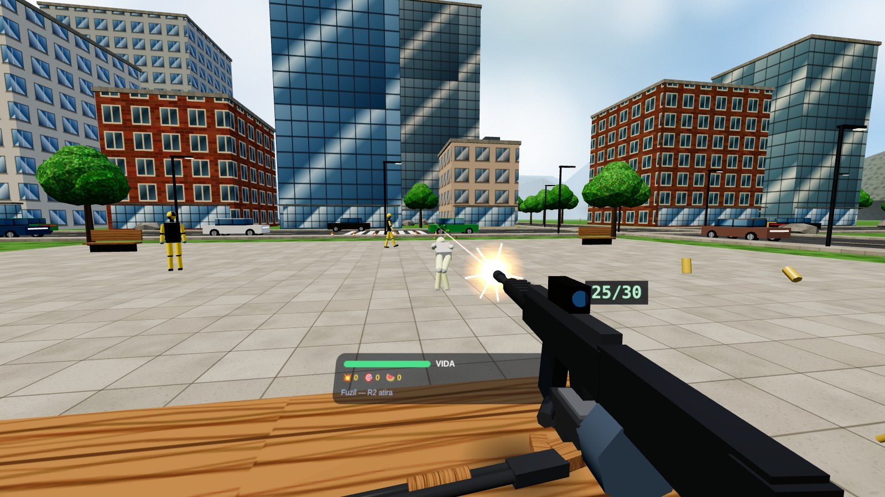
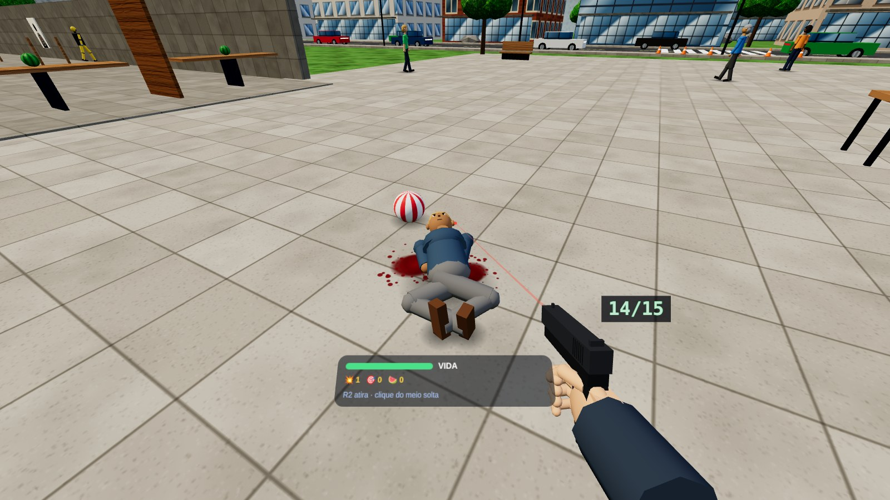
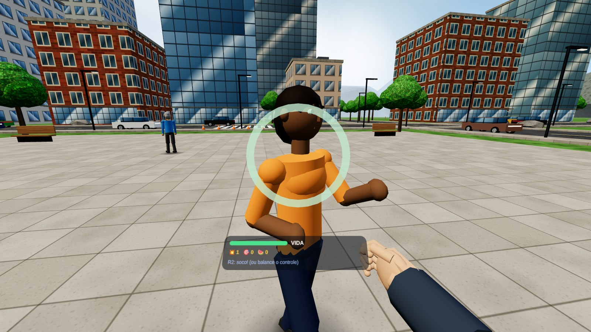
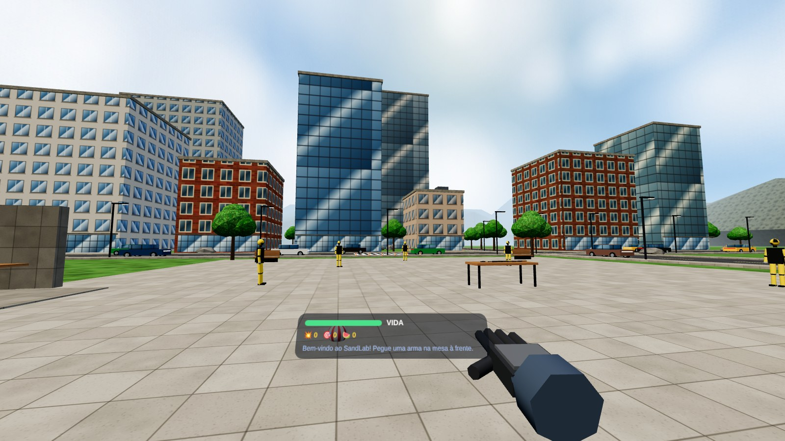
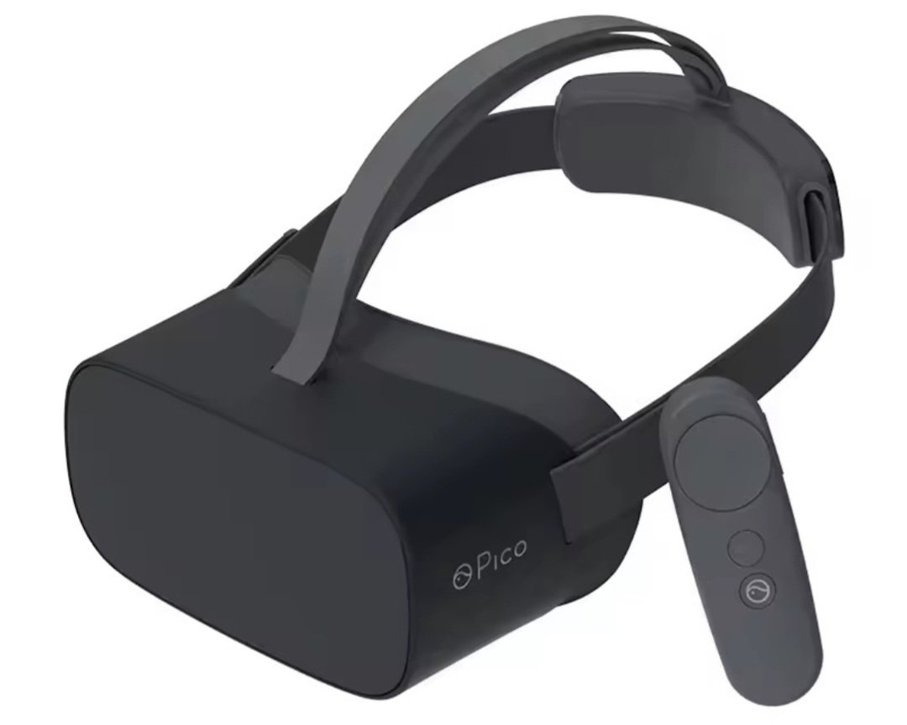

# PicoVerso VR — jogo 3D para Pico G2

Jogo de realidade virtual feito para o **Pico G2** e o controle de 3DoF (estilo Meta Quest): mundos em 360°, personagens 3D que andam e conversam com IA, casas com interior, braços que seguem o controle, sons e música. Tudo roda no navegador, sem instalar nada.

## OpenSaber — WebXR experimental para o G2

- **[Abrir OpenSaber — G2 Web 1.0.0](https://freestylesjoaoemiguel-max.github.io/GAMES-IN-PICOG2/opensaber/)**
- Entre em **INICIAR VR**, escolha **Pico Pulse – Treino**, selecione **1 controle – DIREITA/ESQUERDA** e pressione **Play**. Gatilho seleciona; segurar por 1,2 s durante a música pausa. Faixa original de 52 s incluída.
- Usa o OpenSaber enviado, com correções no pacote Godot e braço estimado para 3DoF; não duplica um controle em duas mãos. O ZIP já era um export web, não um projeto-fonte completo.
- **Requer WebXR immersive-vr + WebGL 2 no navegador do headset.** Partida e controles simulados testados; **PICO G2 físico e desempenho ainda não validados**. Não há garantia de ausência de bugs ou lag. [Instruções, testes e limitações](opensaber/README.md).

## 🧪 SandLab VR — sandbox de mundo aberto (WebXR + APK)

### ▶ Jogar agora
* **WebXR (abra no navegador do Pico → “🥽 Entrar em VR”):** **https://freestylesjoaoemiguel-max.github.io/GAMES-IN-PICOG2/sandlab/**
* **APK para instalar no Pico:** **[SandLab-VR.apk](https://github.com/freestylesjoaoemiguel-max/GAMES-IN-PICOG2/releases/download/sandlab-latest/SandLab-VR.apk)** (`adb install SandLab-VR.apk` · abre em tela cheia com giroscópio)

Cidade aberta com **pessoas 3D** e manequins com ragdoll, armas (pistola, fuzil, escopeta), objetos com física, **soco com a mão vazia** (quem apanha revida — mesmo se você pegar uma arma) e **sangue** com poças.

| | |
|---|---|
|  |  |
|  |  |

**Controles (Pico G2):** R2 = atirar / soco / segurar e arremessar · clique do meio = pegar e soltar · touch = andar · segurar o clique do meio = menu. Detalhes: [`sandlab/README.md`](sandlab/README.md)

## 🏓 Ping-Pong VR (WebXR) — jogar agora

Campeonato de ping-pong em VR para o Pico G2: estádio com torcida, adversário 3D animado, física realista e raquete rastreada pelo controle.

* **WebXR (abra no navegador do Pico → “Entrar em VR”):** **https://freestylesjoaoemiguel-max.github.io/GAMES-IN-PICOG2/pingpong/**
* **APK (modo giroscópio, sem WebXR):** [PingPong-VR.apk](https://github.com/freestylesjoaoemiguel-max/GAMES-IN-PICOG2/releases/download/pingpong-latest/PingPong-VR.apk)
* Como jogar e detalhes: [`pingpong/README.md`](pingpong/README.md)

## 📷 PicoCam — câmera do celular no Pico

Use a câmera do celular dentro do VR (IP ou USB/tethering, zoom 0,5x, giroscópio): [APKs do celular e do Pico](https://github.com/freestylesjoaoemiguel-max/GAMES-IN-PICOG2/releases/tag/picocam-latest) · [`picocam/README.md`](picocam/README.md)

## PICO — imagens de referência

Imagens enviadas pelo usuário para o README do PicoVerso VR, apresentadas separadamente. Mostram o headset, o controle e o menu do sistema PICO; não são capturas do jogo nem comprovação de compatibilidade.

### Headset e controle



### Menu do sistema PICO


## Como jogar

* **Andar:** deslize o **touch de trás** do controle para frente/trás (← → gira em passos de 30°).
* **Clicar:** gatilho ou clique do touch — botões do menu, teclado flutuante, portas, pessoas e estrelas.
* **Menu:** botão lateral do controle, ou o botão **☰ Menu** no painel à sua frente.
* **Objetivo:** encontre as **8 estrelas** de cada mundo (algumas estão dentro das casas — abra a porta e entre!).
* **Conversar:** clique em uma pessoa (ou em **💬 Falar**), digite no teclado flutuante ou toque nas respostas rápidas. O **Pico**, robô do saguão, é a IA geral.

## O que tem

| | |
|---|---|
| Menu | Aba grande e curva estilo navegador (abas, barra de endereço, atalhos), animações, teclado flutuante, tema claro/escuro |
| Mundos | Vila Verde (dia), Oásis do Pôr do Sol (deserto), Vale Nevado (aurora) — céu panorâmico 360°, nuvens, partículas, fonte, moinho, fogueira |
| Personagens | 12 moradores + robô, modelados em 3D, andam pelo mapa, acenam, falam (boca e braços animados) |
| Casas | 6 por mapa, com porta que abre (e bloqueia quando fechada), móveis, janelas acesas e chaminé |
| Braços | Braço em 3D com cotovelo (IK) que aponta para onde o controle aponta, com laser e cursor |
| Som | Efeitos, música generativa por mapa, ambiente (vento, pássaros, sinos) e voz falada das pessoas (síntese do navegador) |
| IA | Conversa em português com memória do seu nome, dicas do jogo, piadas, clima etc. Funciona offline |

## Rodando no Pico G2

O WebXR exige página segura (**HTTPS** ou `localhost`). Opções:

1. **GitHub Pages:** em *Settings → Pages* publique esta branch (pasta raiz). Abra a URL `https://…github.io/…` no navegador do Pico.
2. **Rede local + adb:** no PC, `python3 -m http.server 8000` e `adb reverse tcp:8000 tcp:8000`; no navegador do headset abra `http://localhost:8000`.

Na tela inicial escolha:

* **🥽 Entrar em VR (WebXR)** — recomendado (habilitado se o navegador do headset suportar WebXR).
* **📱 Modo óculos — tela dividida** — plano B: renderiza dois olhos lado a lado e usa o giroscópio. Não corrige a distorção das lentes.
* **🖥️ Jogar na tela** — mouse + teclado (WASD/setas, `M` menu, `Espaço` clique) ou gamepad; ótimo para testar no PC.

### Calibrando o controle

Cada firmware do Pico mapeia os botões de um jeito. No menu vá em **Controle** (🎮): há um teste ao vivo dos eixos/botões e três calibrações — **CLIQUE**, **MENU** e **ANDAR** (toque no botão e depois acione o controle). Sem calibrar, qualquer botão (exceto o 1) clica, o botão 1 abre o menu e o touch anda. Sem controle nenhum, ative **Selecionar com o olhar** em *Ajustes*.

## IA de verdade (opcional)

Por padrão a conversa usa regras locais. Para usar um LLM, publique um endpoint seu (que guarde a chave de API do lado do servidor) que aceite `POST {system, message, player}` e responda `{reply}`, e no navegador execute:

```js
localStorage.pico_ai_url = 'https://seu-servidor/chat'
```

## Estrutura

```
index.html      tela de entrada
lib/three.min.js Three.js r160 (local, funciona offline)
js/audio.js     sons e música sintetizados (WebAudio) + voz
js/brain.js     elenco de personagens e IA de conversa
js/world.js     céus 360°, personagens, casas, mapas, colisão
js/ui.js        painéis 3D, teclado flutuante, telas do menu
js/main.js      renderização, entrada do controle, braços, locomoção
```

> Nota: desenvolvido e testado em Chromium (WebGL, mouse, teclado, gamepad simulado e tela dividida). O caminho WebXR segue a API padrão, mas não foi possível validar em um Pico G2 físico; use a calibração do controle se algum botão se comportar diferente.

## APK e hospedagem (GitHub Actions)

* **APK:** o workflow `Build APK` roda a cada push (ou manualmente em *Actions → Build APK → Run workflow*). Baixe `PicoVerso-apk` em *Artifacts* e instale com `adb install app-debug.apk`. O app é um WebView em tela cheia com o jogo embutido (offline). **WebView não tem WebXR**, então o APK usa o modo *óculos (tela dividida)* ou *tela*.
* **WebXR de verdade:** o workflow `Deploy GitHub Pages` publica o jogo em HTTPS quando algo entra na `main`. Ative em *Settings → Pages → Source: GitHub Actions* e abra a URL no navegador do Pico para usar **Entrar em VR**.

---

## MonkeGo / Gorilla Rush v45 — versão atual

- **[Jogar agora — GMotion 1.0.8 · locomoção do ZIP (WebXR/WebVR)](https://freestylesjoaoemiguel-max.github.io/GAMES-IN-PICOG2/gorilla-rush-v45/?device=picog2&v=1.0.8-gmotion-10)**
- **[Baixar APK e pacote GMotion 1.0.8 — compilação aprovada, code 10](https://github.com/freestylesjoaoemiguel-max/GAMES-IN-PICOG2/actions/runs/45042750368)**

**Download da 1.0.8:** abra a compilação acima e, em **Artifacts**, baixe `Gorilla-Rush-v45-project-screen-APK-reports` (é necessário entrar no GitHub; artefatos têm prazo de expiração).
**Confira a versão no headset:** o painel deve mostrar **FISICA 1.0.8** e **GMOTION / SO MAOS**. Se mostrar outra versão, feche a aba antiga e abra novamente o link acima após a publicação terminar. O parâmetro da URL, sozinho, não comprova a versão carregada.

A versão atual usa o novo arquivo **Gorilla Rush v45** enviado pelo usuário, preservando os dois mapas e os recursos recebidos. Inclui o núcleo de locomoção portado do **Gorilla Movement** enviado pelo usuário: mão bloqueada empurra o corpo, apoio sustenta e soltura usa a média dos últimos 8 movimentos. O ZIP se identifica como Lights Out: Bear Facility, não como código oficial de Gorilla Tag. Colisão contínua e mapas preservados. Usa fontes esquerda/direita disponíveis, sem duplicar um controle. Posição medida quando fornecida; braço estimado por rotação no controle 3DoF. Painel distingue os dois tipos de entrada.

**Como andar (1.0.8):** ao entrar, segure o controle parado 2–3 s (ele aprende sua posição "reta"); depois incline uns 10–15° para baixo e a mão encosta no chão (painel: **CONTATO**). Incline mais para baixo e para trás num gesto rápido: a mão apoia na superfície e você vai para a frente. Volte o controle para cima: a mão solta, volta pelo ar e o impulso continua. Enquanto a mão está apoiada, ela pode sustentar o corpo; ao soltar, ele volta a cair. Com a mão no chão, gire o controle para os lados para ir de lado. **Não precisa apertar gatilho nem usar o touchpad para andar.** Levantar solta a mão mesmo com o gatilho segurado. Caminhada pelo touchpad vem desligada; só é ativada se você escolher essa ajuda no menu.

**APK = jogo em tela/WebView + botão para abrir o navegador VR, não porte VR nativo PICO.**
Gráficos baixos por padrão. Os testes automatizados usam poses simuladas; PICO G2 físico, instalação Android e FPS ainda não validados.
