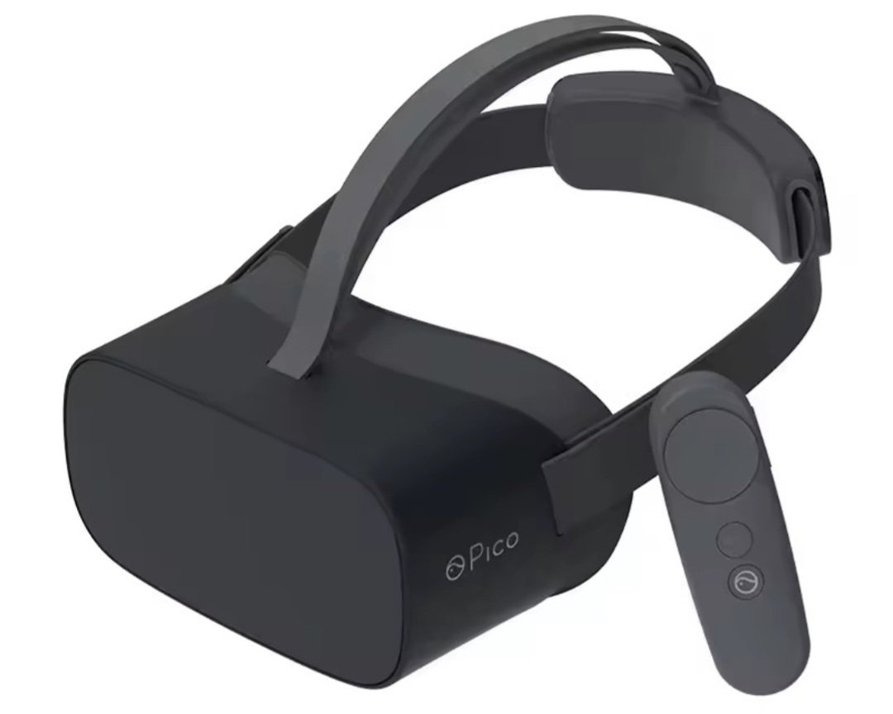
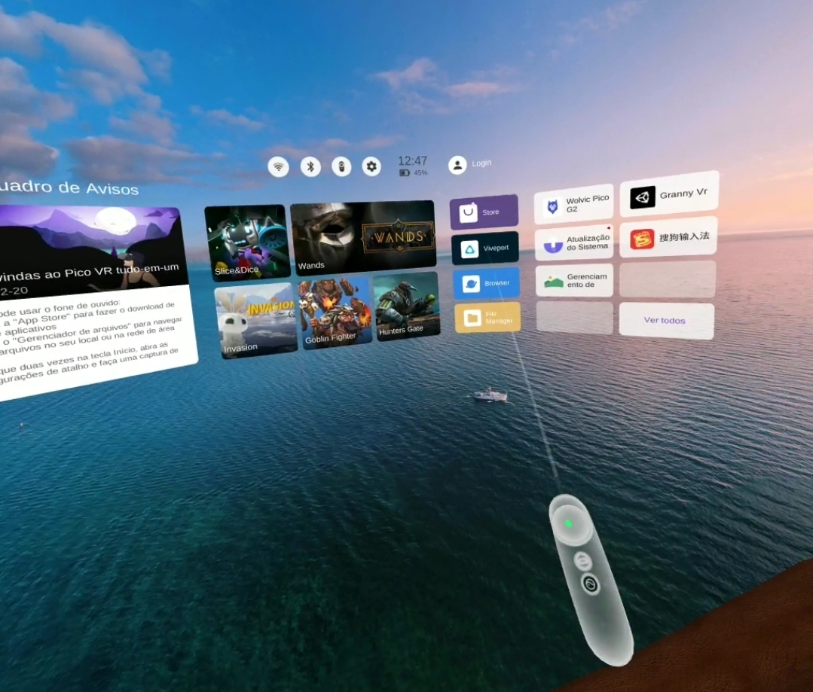

# Discord VR G2 — APK nativo + WebXR

**[Abrir no GitHub Pages](https://freestylesjoaoemiguel-max.github.io/GAMES-IN-PICOG2/discord-vr-g2/)** · **[APK direto](https://freestylesjoaoemiguel-max.github.io/GAMES-IN-PICOG2/discord-vr-g2/downloads/Discord-VR-G2.apk)** · **[Passo a passo fácil](docs/COMO_USAR.md)**

Publicação por `.github/workflows/pages.yml`, após merge na `main`. Preserva o site PicoVerso na raiz e adiciona este app em `/discord-vr-g2/`. Pages é somente modo local, sem backend OAuth2.

Aplicativo **independente**, não afiliado ao Discord ou à PICO. Nome/package/versão: **Discord VR G2**, `com.picog2.discordvrg2`, **1.0.0**. Este projeto está separado do jogo Unity na raiz.

## PICO — imagens de referência

Imagens enviadas pelo usuário, em blocos separados. Mostram o aparelho e o sistema PICO; **não são capturas deste aplicativo nem comprovam compatibilidade**.

### Headset e controle



### Menu do sistema PICO



## Estado real da entrega

**O APK foi compilado em Java, convertido em DEX, empacotado, assinado e verificado neste ambiente.** Não é um APK de outro app renomeado. Não contém WebView, código do aplicativo oficial do Discord, Unity, nem o APK Gorilla Tag enviado anteriormente.

**Não é um cliente Discord completo nem uma versão PICO VR certificada.** Não inclui o runtime proprietário PICO, correção óptica, timewarp ou pose do controle original. A instalação e execução no headset não foram testadas. A interface nativa abre em modo Android monoscópico de desenvolvimento. Um modo estéreo sensorial **experimental, não calibrado** é opt-in; ele não deve ser confundido com suporte PICO VR validado. Interrompa se houver desconforto.

- **APK:** [Discord-VR-G2.apk](web/downloads/Discord-VR-G2.apk)
- **Hash:** [SHA-256](web/downloads/Discord-VR-G2.apk.sha256)
- **Compilação e assinatura reais:** [ANDROID_BUILD.txt](docs/ANDROID_BUILD.txt)
- **Testes de navegador:** [BROWSER_TESTS.json](docs/BROWSER_TESTS.json)
- **Testes de regras/OAuth:** [NODE_TESTS.txt](docs/NODE_TESTS.txt)

A prévia da sessão foi iniciada na porta **5173**. O link HTTPS da Arena é temporário, não um serviço de produção. Abra em uma aba externa para tentar WebXR; um iframe pode bloquear a permissão XR. O navegador antigo de um PICO G2 pode **não** suportar módulos/import maps/WebXR.

## O que funciona no código

### Aplicativo Android nativo

- Java + `GLSurfaceView`/OpenGL ES 2, Android mínimo 23, target 28 para sideload legado.
- Nenhuma biblioteca Google Play Services; nenhuma dependência Unity.
- Painel próprio em Canvas convertido em textura GPU, disposto numa superfície 3D. Não carrega HTML.
- Teclado composto por **meshes 3D individuais**, posições em arco e orientação voltada ao centro; atlas compartilhado.
- QWERTY, números, espaço, enter, backspace, shift, @, ponto e caracteres extras para configurar endereço HTTPS.
- Curvaturas Plano/Suave/VR/Imersivo, padrão VR; tamanho de teclado, painel, distância, cinema, recenter, sensibilidade, inversão, velocidade de cursor e LOW/MEDIUM/HIGH, padrão MEDIUM.
- Cursor/laser **virtual**, raycast geométrico, hover e escala breve ao clicar. Não é uma pose física de controle PICO.
- Entrada por toque, teclado físico, eventos Android de direcional/botões quando o firmware os entregar; orientação experimental pelos sensores Android. O mapeamento real do controle G2 precisa de SDK e teste.
- Mensagens locais privadas ao app, histórico limitado, pesquisa local, navegação e configurações persistentes.
- OAuth2 por navegador externo e pareamento com servidor HTTPS; sessão opaca apenas na memória do app.
- Medidor local de microfone mediante permissão explícita. Sem gravação ou transmissão; **não é chamada Discord**.

### Modo web / WebXR

- Interface própria responsiva, não iframe/WebView do site Discord.
- Prévia espacial 3D, teclado curvo selecionável por raycast, mudança de tamanho/curvatura, cinema, recenter.
- `requestSession('immersive-vr')` quando o navegador e headset suportam. As poses e o estéreo vêm do runtime WebXR; se indisponível, a UI informa isso e fica na prévia 3D.
- Laser de controles a partir de `targetRaySpace` via Three.js, trigger para clicar, eixo vertical de gamepad para rolar mensagens, teclado físico como alternativa.
- Mensagens locais na sessão do navegador; sem falsas respostas de usuários Discord.
- Interface de perfil/servidores/envio via integração quando OAuth2 estiver configurado.

## Limites da integração Discord

Foi consultada a [documentação oficial de OAuth2](https://docs.discord.com/developers/topics/oauth2). Não se usa self-bot, senha capturada, token de sessão do cliente oficial ou API privada.

| Função | Implementação / condição |
|---|---|
| Login/logout | Authorization Code no servidor confidencial, `state` de uso único, cookie seguro, revogação no logout |
| Perfil | OAuth2 `identify` |
| Servidores | OAuth2 `guilds`; até 100 itens nesta versão |
| Envio real | `webhook.incoming` **opcional**, escolhido explicitamente pelo usuário no Discord |
| Identidade do envio | `Discord VR G2 · integração`, com atribuição textual; não como mensagem nativa da conta pessoal |
| Leitura/histórico geral/recebimento em tempo real | **Não disponível nesta integração**; mostra somente envios desta sessão ou histórico local |
| DMs/amigos/presença/notificações Discord | **Não implementados**. Amigos têm caminho via Social SDK sujeito aos termos/acesso; isso não está integrado |
| Canais de voz | **Não implementados**; dependem de SDK/API permitida, acesso e compatibilidade adicional |
| Microfone | Somente teste de nível local, iniciado pelo usuário |
| Anexos | Não implementados; a UI explica em vez de fingir enviar |

A autorização `webhook.incoming` não concede leitura geral de canais. Alterar o servidor visual não concede acesso a outro canal: o servidor valida o ID do canal contra o webhook autorizado. Menções em massa são desabilitadas (`allowed_mentions.parse=[]`). Reenvios com o mesmo request ID não duplicam a publicação durante a sessão.

**Na prévia entregue o OAuth2 está desabilitado**, porque não foram fornecidos client ID/secret/origem de uma aplicação Discord. O ambiente também limita saída de rede; implante o backend onde haja HTTPS de saída para `discord.com`. Testes OAuth/webhook usaram respostas simuladas e **não comprovam** autorização ou entrega real no Discord.

## Executar a prévia

Requisitos: Node.js 22 e npm.

```bash
cd discord-vr-g2
npm ci --ignore-scripts
npm start
```

Servidor em `0.0.0.0:5173`, assets e API na mesma origem. Não há URLs `localhost` embutidas no código de navegador ou Android para alcançar o backend.

- **Explorar sem conta:** navegue pelos espaços marcados LOCAL, digite e abra Prévia espacial.
- **Entrar em VR:** use o botão em um navegador compatível, HTTPS e aba externa; aceite a solicitação real de sessão.
- **Olhar na prévia desktop:** arraste com botão direito; clique esquerdo nas teclas 3D; roda do mouse rola mensagens.
- **Teclado físico:** caracteres, backspace e enter; Ctrl/Cmd+K pesquisa na interface 2D.
- **APK:** no site, Aplicativo Android apresenta os limites antes do download.

## Configurar OAuth2 legítimo

Cadastre sua própria aplicação no [Discord Developer Portal](https://discord.com/developers/applications). Não envie segredos por chat nem os coloque no APK/Git.

Configure no **servidor**, por variáveis de ambiente:

```text
PUBLIC_ORIGIN=https://seu-dominio
DISCORD_CLIENT_ID=ID_DA_SUA_APLICACAO
DISCORD_CLIENT_SECRET=SEGREDO_SOMENTE_NO_SERVIDOR
PORT=5173
```

Registre no portal **exatamente** o redirect URI:

```text
https://seu-dominio/auth/callback
```

A origem precisa ser HTTPS, sem caminho e sem barra final. Configure seu reverse proxy para TLS e não registre códigos OAuth, cookies, Authorization ou tokens nos logs. O Node não carrega `.env` automaticamente; exporte as variáveis no gerenciador de processos/hosting. `.env.example` é somente um exemplo dos nomes.

### Android

Abra Entrar no Discord, informe a **origem HTTPS de um servidor confiável seu**, salve e escolha:

- **Entrar no Discord:** perfil e servidores;
- **Autorizar envio em um canal:** inclui webhook.incoming, com escolha de canal no Discord.

O navegador externo recebe a autorização. Volte ao app; ele consulta um pareamento temporário de uso único, protegido por segredo de polling. O APK recebe um token **da sessão deste backend**, não o token OAuth/segredo Discord. Login expira e pode precisar ser repetido. Não há uma credencial fictícia embutida.

O backend guarda sessões/tokens somente na memória, por até uma hora. Reiniciá-lo encerra as sessões. Não há refresh automático nem banco permanente. Essa implementação é para desenvolvimento; precisa de revisão operacional de segurança/escala antes de produção.

**Logout:** remove a sessão e tenta revogar o OAuth. Webhooks criados podem permanecer no servidor Discord após logout; remova-os em Configurações do servidor → Integrações quando quiser revogar permanentemente esse canal de envio.

## Compilar Android — sem licença Unity

A build usa compilador Eclipse (ECJ), D8, AAPT2 e apksigner. Dependências de compilação **não** são embutidas no app. Consulte [TOOLCHAIN](docs/TOOLCHAIN.md) para proveniência, mirrors, hashes e licenças.

Linux x86_64, Python 3.11+, Node/npm:

```bash
bash discord-vr-g2/tools/bootstrap_android.sh
```

Ou, com os tools já preparados, na raiz do repositório:

```bash
.venv/bin/python discord-vr-g2/tools/build_android.py
```

Saída: `discord-vr-g2/web/downloads/Discord-VR-G2.apk`. O script verifica os hashes dos tools, compila os **quatro arquivos Java próprios**, gera DEX, empacota resources, assina e verifica assinatura/manifest/integridade. Nenhum template WebView, runtime Bun ou código do pacote usado como mirror é utilizado.

APK pequeno (dezenas de KB), porque não leva engine, assets externos nem bibliotecas nativas: o desenho vem de Java/Canvas/GLES fornecidos pelo Android. Tamanho pequeno não significa ser um atalho web. A classe `MainActivity`, renderer, painel e rede estão no DEX.

A primeira execução gera uma **chave de desenvolvimento local** em `.cache/android`, fora do Git. Ela não é identidade de produção e pode desaparecer com o sandbox. Para builds atualizáveis, forneça uma keystore própria por `SIGNING_KEYSTORE`, `SIGNING_PASSWORD_FILE` e `SIGNING_ALIAS`; nunca grave a senha no script.

Workflow separado: `.github/workflows/build-discord-vr-g2.yml` (**Discord VR G2 - APK and WebXR**). Ele instala dependências, testa JS/OAuth mockado, compila/assina o APK, empacota o WebXR estático e executa testes de navegador no pacote servido em subpasta. Os resultados de cada execução ficam em GitHub → Actions.

Artefatos (retenção de 30 dias):
- `Discord-VR-G2-1.0.0-development`: APK, SHA-256 e relatórios.
- `Discord-VR-G2-WebXR-static`: site completo, Three.js e APK, pronto para extrair e servir em HTTPS. É **modo local**, sem backend OAuth2. O site existente do repositório não é substituído.

Para gerar só o pacote web: `cd discord-vr-g2 && node tools/build_web.mjs`. Saída: `build/webxr/`. Sirva por HTTPS; abrir por `file://` não funciona. O caminho pode ser raiz ou subpasta.

**Assinatura CI:** sem keystore própria configurada, cada execução gera uma chave de desenvolvimento diferente. Não é uma atualização compatível da assinatura do APK local/anterior; reinstalar pode apagar dados. A chave privada não é publicada nos artefatos.

## Instalar por ADB

Com depuração USB autorizada e ADB instalado em seu computador:

```bash
adb devices
adb install -r discord-vr-g2/web/downloads/Discord-VR-G2.apk
adb shell am start -n com.picog2.discordvrg2/.MainActivity
adb logcat -s AndroidRuntime
```

Não se exige Google Play Services. Sideload pode depender da configuração administrativa/firmware do aparelho. Um APK com outra chave não atualiza por `-r`: não desinstale sem preservar dados que queira manter.

**Controles alternativos Android:** toque seleciona; dois dedos arrastam a vista quando o sensor está desligado; direcional move o cursor; centro/A/R1/R2 confirma, se os eventos forem entregues pelo firmware; MENU abre configurações; BACK fecha teclado/volta; teclado físico escreve. HOME continua do sistema. Isso **não comprova** o funcionamento do controle proprietário G2.

## Performance e conforto

- GLES2, sem iluminação 3D, sombras, pós-processamento, física ou modelos pesados.
- Panel texture LOW 960×600, MEDIUM 1280×800, HIGH 1536×960; atlas do teclado 1024×640.
- Redesenho do painel em alterações de estado, não em toda consulta de rede.
- `RENDERMODE_WHEN_DIRTY` no Android; sensores desligados por padrão. Em orientação experimental, frames acompanham eventos do sensor.
- WebXR sem luzes dinâmicas; renderer da sessão mantém a cadência do runtime. Prévia não imersiva limitada por qualidade a 30/45/60 FPS.
- Botões 3D reutilizam atlas; histórico limitado; não há polling geral de Discord.
- Tamanho/curvatura excessivos podem exigir olhar ao redor; recenter restaura a frente.

Nenhum número de FPS, latência, RAM ou temperatura em G2 foi medido. Não use estéreo não calibrado prolongadamente. O perfil padrão é monoscópico de desenvolvimento, não uma declaração de segurança/conforto no headset.

## Testes

```bash
cd discord-vr-g2
npm test
# Com o servidor rodando na porta 5173:
node tools/check_browser.mjs
```

**Executado:** compilação Java/DEX/APK, verificação criptográfica, manifest e ZIP; 19 testes Node; 11 verificações de navegador, inclusive raycast em tecla curva e download byte a byte do APK. Capturas: [desktop](docs/preview-desktop.png), [espacial](docs/preview-spatial.png), [mobile](docs/preview-mobile.png).

**Não executado:** instalação/emulador, execução Android, G2 físico, lentes/compositor/controle PICO, sessão WebXR imersiva, autenticação com conta Discord real, publicação real por webhook, chamadas de voz. Veja a [matriz de aceitação](docs/DEVICE_TESTS.md).

## Para chegar ao aplicativo PICO solicitado integralmente

Ainda é necessário integrar um SDK/runtime **oficial compatível com G2**, substituir a entrada alternativa pela pose real do controle 3DoF, implementar a camada nativa de estéreo/compositor correspondente e testar no aparelho. Isso não é obtido adicionando um flag `vr` ao manifest. Funções Discord adicionais exigem uma integração oficialmente permitida e, quando aplicável, acesso/aprovação do fornecedor.

Esta entrega fornece APK original compilado, UI própria, integração pública limitada e modo WebXR testável. Não afirma completar essas dependências ausentes.

## Licença

Código, geometria e identidade visual original: MIT (licença na raiz). Three.js e ferramentas mantêm suas licenças; veja [THIRD_PARTY](docs/THIRD_PARTY.txt). Nenhum logo Clyde, asset de jogo comercial ou código proprietário do cliente Discord foi copiado. Fontes do sistema Android/navegador são usadas no dispositivo.
