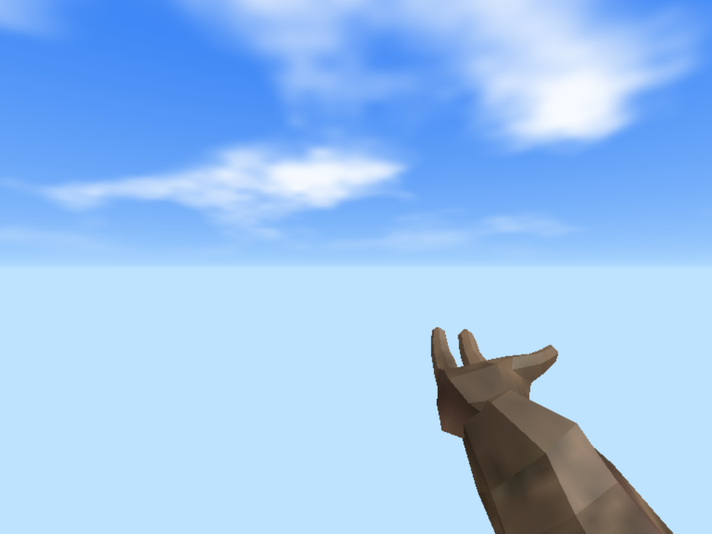

# MonkeGo para PICO G2 — Gorilla Rush

Adaptação do **projeto fornecido pelo usuário**, não um jogo substituto. Preserva os assets, mapa, modos SoloPlay/Lava Run e código de Gorilla Rush, creditado a **WelliDev** no ZIP.

- **Jogar:** https://freestylesjoaoemiguel-max.github.io/GAMES-IN-PICOG2/monke-go/?device=picog2
- **APK:** https://freestylesjoaoemiguel-max.github.io/GAMES-IN-PICOG2/monke-go/downloads/MonkeGo-PicoG2.apk
- **Pacote web:** https://freestylesjoaoemiguel-max.github.io/GAMES-IN-PICOG2/monke-go/downloads/MonkeGo-WebXR.zip

## Importante: o que o APK é

O arquivo de entrada é HTML/JavaScript/Three.js, **não Unity nem um projeto nativo PICO**.
O APK Android compilado neste repositório contém o jogo completo localmente para **modo tela, em WebView**, e um botão **ABRIR EM VR**, que abre o site HTTPS no navegador externo.

**O APK não é um porte VR nativo e não inclui o SDK/compositor PICO.** A WebView não fornece WebXR/WebVR imersivo. Não foi testada a instalação nem a execução no Android/G2 físico. O modo tela depende de Android System WebView com WebGL/JavaScript compatíveis. O pacote é `com.picog2.monkego`, versão 1.3.0, Android mínimo 6/API 23.

O modo VR do **site** utiliza WebXR, ou WebVR 1.1 quando exposto pelo navegador. Se o firmware/navegador do G2 não oferecer nenhuma dessas APIs, o site não pode fabricar acesso ao runtime. Não afirmamos compatibilidade de um navegador alternativo específico com o G2.

## Usar no PICO G2

1. Abra o link **Jogar** no navegador do headset (HTTPS).
2. Aguarde o modelo e mapa; o diagnóstico informa WebXR/WebVR disponíveis.
3. Se aparecer **ENTRAR EM VR (PICO G2)**, clique; o menu aparece dentro da cena.
4. Apoie a mão no chão e gire o controle para baixo/trás, depois levante para soltar e repita: o corpo se desloca no sentido oposto, sem precisar do gatilho. Gatilho segura o contato; clique curto no touchpad pula; bordas giram; segurar o touchpad abre o menu. App também abre o menu se o sistema repassar esse botão.
5. Abra **Dispositivo** no menu para ver fonte, layout e índices de botões pressionados.
6. No layout legado, ajuste índices de gatilho/touchpad/App em **Ajustes**. Também é possível trocar eixos e inverter vertical. No layout `xr-standard`, o padrão WebXR tem precedência.
7. Para recentrar fisicamente, use a função de recentralização do próprio sistema PICO. Home pode ser reservado pelo sistema.

O G2 possui orientação **3DoF**, não posição medida da mão. A posição da mão direita é estimada pelo modelo de braço do jogo. **O braço esquerdo foi desativado: não aparece, não colide, não empurra e não alterna com o direito.** Não é rastreamento 6DoF. Gráficos **Baixos** são o padrão; isso não é promessa de FPS.

No computador: WASD/setas movem, arrastar olha, Espaço pula, M/Escape abre o menu. SoloPlay/Lava Run não exigem servidor; multiplayer continua PeerJS e precisa de internet, sinalização e eventualmente TURN. GitHub Pages não hospeda o servidor Node em `server/`.

## Atualização 1.3 — andar pelo chão e pulso 360°

A mão já acompanhava o controle na 1.2, mas o contato deslizava tangencialmente: levantava o corpo sem transmitir tração horizontal. O teste antigo só verificava esse impulso vertical.

- **Mão aberta no chão agora mantém um ponto de apoio durante o gesto**, deslocando o corpo no sentido oposto. Sem gatilho e sem joystick. Ao levantar a mão, o apoio solta; no ar não há propulsão artificial. Paredes continuam permitindo deslizamento; gatilho mantém a opção de agarrar.
- Alcance estimado para baixo ampliado, limitado pelo comprimento do braço: o piso fica acessível sem exigir apontar quase verticalmente. Isso não adiciona rastreamento de posição ao controle 3DoF.
- **Pulso livre em 360° nos três eixos**, usando quaternion, sem limite de ângulo de Euler. Torcer o pulso não é mais confundido com recentralização que cancela o apoio. Saltos grandes de direção ainda reinicializam a física por segurança.
- Corrigida colisão de um raio deslocado que podia prender a mão na face inferior do piso ao levantá-la.
- Novas regressões: avanço e movimento lateral sem botão, soltura, ausência de deriva parado, volta completa do pulso e alcance do chão. No navegador, três ciclos de apoio/empurrão/soltura avançaram cerca de **2,34 m**, com gravidade e sem teclas/joystick. O esqueleto real completou 360° nos três eixos. São testes de poses simuladas, não medições no headset.

**Como andar no G2:** feche o menu, aponte cerca de 45–55° para baixo até a mão encostar; gire mais para baixo e para trás para empurrar o corpo para a frente. Levante a ponta para soltar e repita. Não precisa apertar o gatilho. Só transladar o controle real, sem girá-lo, não fornece posição ao jogo em 3DoF.

## Histórico 1.2 — a mão do gorila é o controle

O usuário confirmou: navegador em VR, apontador funcionando, mas mão sumida/parada. Foram corrigidos dois caminhos concretos: o menu recolhia o braço abaixo da visão e o teste amplo por `touch` confundia `generic-trigger-touchpad` com controle Touch 6DoF.

- **A mão continua sendo renderizada e atualizada com o menu aberto.** O laser parte do pulso do gorila, não de um controle separado no ombro.
- O osso da mão recebe a orientação do controle nos três eixos (pitch/yaw/roll), incluindo torcer o pulso. Gatilho também fecha os dedos. A posição, e somente ela, continua estimada a partir do ombro/cotovelo.
- Pose neutra à frente e abaixo dos olhos, com cotovelo dobrado. O braço usa IK de dois segmentos; não é um ragdoll nem um braço 6DoF medido.
- Perfil **PICO G2 · orientação 3DoF** é padrão. Automático reconhece `emulatedPosition` e não confunde touchpad com Touch. Só usa dados válidos de pose fornecidos pelo runtime, não eixos de joystick como rotação.
- **Locomoção original inspirada no princípio de Gorilla Tag:** contato aproximado de uma esfera de mão de 7,5 cm, varredura ao longo do movimento, deslizamento nas superfícies e corpo empurrado no sentido contrário. Empurrar não exige gatilho; o gatilho é opcional para manter o contato.
- Sem a atração anterior de meio metro para o chão nem impulsos artificiais calculados só pela velocidade angular. A soltura conserva velocidade medida e limitada. Não é a implementação exata de Gorilla Tag, nem substitui suas mãos 6DoF.
- Perda de pose deixa a mão em repouso visível e mostra **SEM POSE DO CONTROLE**, sem fingir rastreamento. O braço esquerdo continua desativado.

### Conferir no headset

1. Reabra o site; procure **VERSÃO 1.3 · TRAÇÃO NO CHÃO · MÃO 360°**.
2. Em Ajustes, deixe **Controle: tipo de rastreamento → PICO G2 · orientação 3DoF**.
3. Entre em VR. Aponte o controle para a frente: a mão direita deve estar visível também no menu. Gire e torça o pulso para verificar os três eixos.
4. Feche o menu, aponte para o chão até a mão encostar e empurre a superfície. No G2 isso é um gesto de rotação com posição estimada, não translação física rastreada.
5. Se aparecer SEM POSE, reconecte/recentre o controle e consulte **Dispositivo**. Se só o laser funcionar, reporte a API/fonte mostrada e envie um vídeo: os testes automatizados não garantem o comportamento de cada firmware.



*Captura real Chromium/WebGL em cena controlada, com pose XR simulada; não é captura de um PICO G2 físico.*

## Histórico 1.1 — somente braço direito

- Não precisa limpar seus dados: perfis antigos com mão esquerda, espelhamento ou troca automática são migrados para `simHand=0`, `handed=right`, preservando os demais ajustes.
- As opções de duas mãos e seleção de mão foram removidas. Um único controle sempre move o braço **direito**, mesmo se o firmware o rotular como esquerdo.
- O braço esquerdo foi retirado da malha renderizada (sem alterar o GLB original) e ignorado pela física; suas posições antigas não ativam colisões ou tag local.
- Removidas a mão plantada, alternância automática e mão com atraso. Filtro da mão direita não depende mais do processamento da esquerda.
- Movimento da escalada aplicado **uma vez** por quadro; anteriormente o ajuste da âncora era seguido de outra integração da mesma velocidade.
- Menu, respawn, giro instantâneo, perda de pose e reconexão reinicializam o estado. Um gatilho já pressionado precisa ser solto antes de agarrar novamente. Cancelamentos não aplicam impulso de arremesso.
- Mudança brusca de orientação/recentralização reinicia o filtro; velocidade angular e impulso da mão são limitados. Abertura/fechamento do menu não reativa contatos antigos.
- Há 80 ms de proteção contra impulso após reinicializar a pose, sem simular rastreamento inexistente.

Abra novamente o site/recarregue a aba. A página mostra a versão atual **1.3 · TRAÇÃO NO CHÃO · MÃO 360°** e usa URLs versionadas dos scripts para evitar misturar código antigo. Para o APK, baixe a versão nova; assinatura de desenvolvimento diferente pode exigir reinstalação (veja abaixo).

## Correções anteriores desta adaptação

- Pose WebXR consultada pelo `XRInputSource.targetRaySpace` correto, no `XRFrame` atual e no mesmo espaço de referência. Não associa mais o índice da lista de fontes ao índice interno do Three.
- Eventos de seleção associados ao objeto da fonte (WeakMap), não a um índice que muda ao reconectar.
- Orientações inválidas/ausentes descartadas e quaternions normalizados; sem fallback para pose Gamepad obsoleta durante uma sessão XR.
- Perda/troca de fonte limpa âncora de escalada, filtro de braço e clique pendente: desconectar não produz um salto falso.
- `xr-standard`: separação entre pares de eixos touchpad/stick; zero não vira um eixo do outro dispositivo. Clique do stick não é tratado como App/Menu.
- Layout legado configurável também em fontes WebXR que não anunciam `xr-standard`; diagnósticos atualizados.
- Cabeça em WebXR lida da pose atual antes da física; inicialização espera a entrada em VR antes de iniciar o jogo.
- Android explicitamente em modo tela; não cai em Cardboard e não solicita câmera fingindo rastreamento PICO.

## Build e testes

Na raiz do repositório:

```sh
bash monke-go/tools/bootstrap_android.sh
cd monke-go
npm ci --ignore-scripts
npm test
npm run build
npm start
# Em outro terminal:
npm run test:browser
```

- `build_android.py`: Java → DEX → recursos Android → APK assinado v1/v2. Ferramentas com hashes verificados; mesma cadeia documentada em `../pulse-saber-g2/docs/TOOLCHAIN.md`. Nenhum template/runtime de terceiros é embutido pelo compilador.
- Verifica manifesto, assinatura, DEX, integridade ZIP e igualdade byte a byte dos assets/scripts empacotados.
- `build_web.mjs`: exporta site portátil para `build/webxr`, sem servidor, caches ou chaves.
- Workflow **Build MonkeGo APK and WebXR**: compila e testa em GitHub Actions, disponibiliza APK, checksum, pacote web e relatórios.
- Workflow **Deploy GitHub Pages**: recompila no GitHub e publica `/monke-go/`, preservando PicoVerso, Discord VR G2 e Pulse Saber G2.

**Assinatura de desenvolvimento:** cada runner sem uma chave configurada gera um certificado novo. Pode ser necessário desinstalar a versão anterior, perdendo dados locais. Para atualizações persistentes configure uma chave privada com `SIGNING_KEYSTORE`, `SIGNING_PASSWORD_FILE`, `SIGNING_ALIAS`; não coloque chaves/senhas no Git. O APK não é distribuição oficial PICO nem loja Android.

### Evidência e limites

37 testes Node cobrem mapeamento, pose, identidade da fonte, desconexão e integridade dos assets. 17 verificações gerais Chromium cobrem carregamento real WebGL, Solo, Lava, menu, download APK e **WebVR simulado**. Mais **12 verificações específicas da mão/física** testam orientação do osso real, cotovelo, projeção, pixels realmente renderizados, menu, empurrão sem gatilho, três ciclos de caminhada horizontal, giro 360° e soltura. Usam um XRFrame simulado com o renderizador, malha e física reais. Relatório `docs/HAND_TESTS.json` e capturas `docs/preview-hand-*.png`. Relatórios gerais em `docs/NODE_TESTS.txt`, `docs/BROWSER_TESTS.json`, `docs/ANDROID_BUILD.txt`. Os artefatos de cada execução CI contêm os relatórios e checksums correspondentes àquele build; o APK local pode ter outra assinatura.

**Não testados:** headset PICO G2 físico, instalação Android, navegador real do G2, sessão WebXR imersiva real, FPS, temperatura, conforto, multiplayer na internet. Testes de WebXR usam mocks de frame/espaço; não substituem teste físico. Os documentos originais relatam testes de outra execução: veja `docs/*_ORIGINAL.md`, não confunda com estes resultados.

## Origem/licenças

[Créditos e ressalvas](CREDITS.md). Hash do ZIP e assets em `docs/INPUT_PROVENANCE.json`. A licença MIT da raiz **não altera licenças dos assets recebidos**. Não foram adicionados assets proprietários novos, nem há comprovação de licença individual de todos os materiais recebidos.
