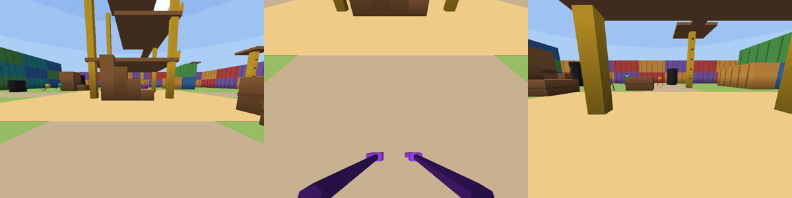

# PICO VR: PEGA-PEGA

Jogo de **pega-pega com locomoção pelos braços** para **Pico G2 / G2 4K**, inspirado na *mecânica* dos
jogos de "arm locomotion" (como Gorilla Tag), mas com identidade própria: personagens, mapa, sons e nome
originais. Você é um **Rolo**, um robozinho redondo de braços compridos, no **Pátio Ferro-Velho**.

**[⬇ Baixar PICO-VR-Pega-Pega.apk](https://github.com/freestylesjoaoemiguel-max/GAMES-IN-PICOG2/raw/ccr-3de8f23e-tx6y3b/release/PICO-VR-Pega-Pega.apk)**
· pacote `com.joaolimz.pegapega` · versão 1.0.0 · 100% offline (só a permissão `VIBRATE`)

```
adb install -r PICO-VR-Pega-Pega.apk
adb shell am start -n com.joaolimz.pegapega/.MainActivity
```




*Imagens da cena real do jogo desenhada por um rasterizador de teste em CPU (sem texto); não são capturas do headset.*

## Como se mexer (não existe andar!)

A locomoção usa **o mesmo algoritmo do GorillaLocomotion** (código aberto da Another Axiom, licença MIT,
ver [THIRD_PARTY_NOTICES.md](THIRD_PARTY_NOTICES.md)) com os mesmos parâmetros: a mão **gruda** onde toca,
o corpo se move pelo oposto do movimento da mão, as duas mãos juntas fazem média, o pulo usa a média da
velocidade dos últimos quadros × **1,1** (máx. **6,5 m/s**) e a mão solta ao se afastar **1 m** do ponto preso.

1. **Aponte o controle para baixo** até a mão tocar o chão: ela gruda (a mão fecha e o controle vibra).
2. **Puxe para trás/para baixo** (gire o punho e mova o braço): o corpo vai **para frente**.
3. **Pular:** bata/empurre **rápido para baixo** e levante: você é lançado com a velocidade do empurrão.
4. **Escalar:** encoste a mão na parede ou no poste e **puxe para baixo**; levante o braço para a mão
   deslizar e agarrar mais alto.
5. **Girar:** polegar nos lados do touchpad. **Recentralizar:** segure **Home** ~1 s.

### Sensor de movimento do controle
Além da rotação (giroscópio), o jogo lê o **acelerômetro** do controle do G2 pelo serviço do sistema:
**empurrões, puxões e balanços reais do braço movem a mão** no jogo (até ~45 cm), somados ao braço longo
que segue a direção do controle. A calibração de 6 passos também descobre os eixos do acelerômetro.
A tela *DIAGNÓSTICO* mostra o acelerômetro e quantos centímetros a mão se moveu.

### Adaptações necessárias ao Pico G2
O Pico G2 tem **um controle 3DoF** e não rastreia posição (o acelerômetro só dá movimentos curtos, não a
posição absoluta). Por isso:
- os **dois braços longos seguem o controle** a partir dos ombros (ou um só, trocando com APP);
- "pernas" mantêm a cabeça na altura escolhida (no VR com rastreamento seria a sua altura real);
- **ajuda na escalada** (desligável): a mão presa numa parede continua "pressionando" e desliza para cima ao
  levantar o braço, porque um braço de tamanho fixo não consegue empurrar a parede como um braço real.

Em *Movimento*: comprimento do braço, altura, multiplicador de pulo, sensor de movimento (liga/força),
ajuda na escalada e andar pelo touchpad (desligado por padrão).

**Sobre ser "igual" ao Gorilla Tag:** a *mecânica* é a mesma do código aberto; o nome, os gorilas, o mapa da
floresta, os sons e a arte do Gorilla Tag são conteúdo protegido e não foram copiados: aqui você joga com os
Rolos no Pátio Ferro-Velho.

## Modos

| Modo | Regras |
|---|---|
| **INFECÇÃO** | Começa com 1 infectado (roxo, com aura). Quem é tocado vira infectado. Infectados vencem se pegarem todos; sobreviventes vencem quando o tempo (2:30) acaba. |
| **PEGA-PEGA** | Um pegador (com coroa). Ao tocar alguém, passa a vez (sem "volta" imediata). Vence quem passou menos tempo como pegador (2:00). |
| **TREINO LIVRE** | Sem pegador: treine os movimentos e explore. |

Encostar com as **mãos ou o corpo** conta. Os outros jogadores são **bots com IA** (1 a 9, fácil/normal/difícil):
perseguem prevendo seu movimento, fogem, desviam de obstáculos, escalam paredes e fogem para lugares altos.
Rodadas se repetem automaticamente; o **placar** fica no telão do lado sul do pátio.

## Controle Pico G2

O controle é lido do serviço de controle do sistema Pico (mesmo método do *Operation Zero*, sem SDK
embutido). Na primeira vez abre a **calibração de 6 passos** (frente, cima, direita; centro, cima e direita do
touchpad). *CONTROLE PICO → DIAGNÓSTICO* mostra os dados ao vivo. Gatilho: selecionar nos menus.
**APP:** trocar braço / segurar = pausa.

## Técnica e desempenho

- Motor próprio (Java + OpenGL ES 3.0) compartilhado com o *Operation Zero*: estéreo, pré-distorção de lente,
  iluminação baked, qualidade LOW por padrão.
- Locomoção: port do GorillaLocomotion (`game/player/ArmRig.java`, `game/physics/SphereCast.java`) +
  acelerômetro do controle (`game/input/ImuHand.java`, `platform/PicoControllerClient.java`).
- Bots: física de saltos com as mãos, escalada de parede, desvio por raycasts, pontos altos pré-definidos
  (`game/tag/BotSystem.java`). Regras e rodadas: `game/tag/TagGame.java`.
- Tudo original e procedural: modelos (`game/mesh/Assets.java`), mapa (`game/world/Arena.java`) e 18 sons
  sintetizados (`game/audio/SoundSynth.java`).

### Testes (`pegapega/src/test`)
`pushingTheGroundBackwardsMovesForward`, `fastDownwardPushJumps`, `climbsAWallByPullingDown`,
`standsStillWithArmsUp`, `botsInfectEveryoneEventually`, `playerCanTagABotWithHands`,
`gameRendersAndSoundsSynthesize`, `ImuTest.calibrationFindsAccelerometerAxesAndUnits` (eixos/unidades do
acelerômetro, sem deriva parado, empurrão move a mão), `ImuTest.realDownwardPushOnTheFloorJumps` (empurrão
real do braço contra o chão faz pular) — rodam o código real do jogo na JVM.

### Limitações
- Sem multijogador online (o projeto é offline por requisito; os outros jogadores são bots).
- Não testado em um Pico G2 físico aqui: locomoção, calibração e desempenho foram validados por simulação.

### Compilar
`./gradlew :pegapega:assembleRelease` ou `MODULE=pegapega tools/build-apk-manual.sh /caminho/android.jar`.
