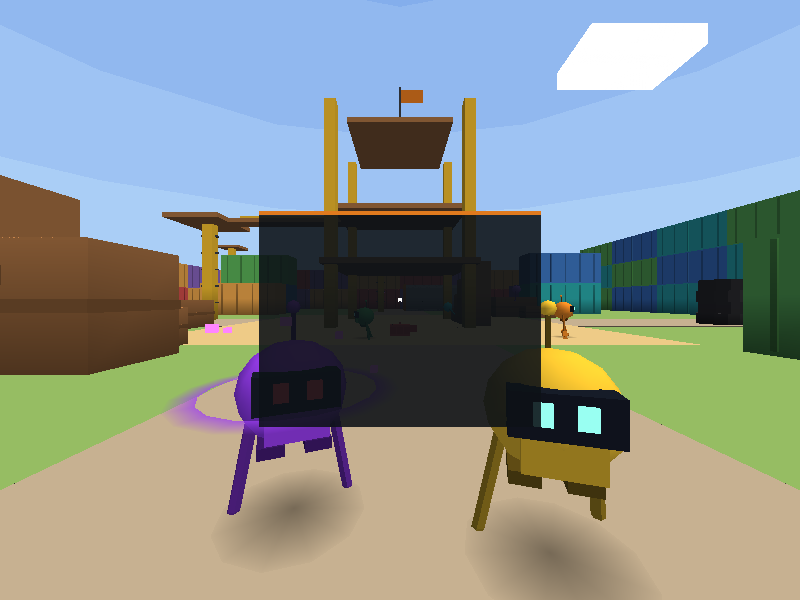

# PICO VR: PEGA-PEGA

Jogo de **pega-pega com locomoção pelos braços** para **Pico G2 / G2 4K**, inspirado na *mecânica* dos
jogos de "arm locomotion" (como Gorilla Tag), mas com identidade própria: personagens, mapa, sons e nome
originais. Você é um **Rolo**, um robozinho redondo de braços compridos, no **Pátio Ferro-Velho**.

**[⬇ Baixar PICO-VR-Pega-Pega.apk](https://github.com/freestylesjoaoemiguel-max/GAMES-IN-PICOG2/raw/ccr-3de8f23e-tx6y3b/release/PICO-VR-Pega-Pega.apk)**
· pacote `com.joaolimz.pegapega` · versão 1.0.0 · 100% offline (só a permissão `VIBRATE`)

```
adb install -r PICO-VR-Pega-Pega.apk
adb shell am start -n com.joaolimz.pegapega/.MainActivity
```




*Imagens da cena real do jogo desenhada por um rasterizador de teste em CPU (sem texto); não são capturas do headset.*

## Como se mexer (não existe andar!)

1. **Aponte o controle para baixo** até a mão tocar o chão: ela **gruda** (a mão fecha e o controle vibra).
2. **Puxe o controle para trás/para baixo** (gire o punho para trás): seu corpo é empurrado **para frente**.
3. Levante o controle (aponte para frente) para soltar e repita: é como "remar" no chão.
4. **Pular:** apoie no chão e empurre **rápido para baixo**, depois solte: você é lançado com a velocidade do empurrão.
5. **Escalar:** encoste a mão numa parede/poste (aponte para frente-cima), **puxe para baixo** para subir e
   **levante o braço** para a mão deslizar para cima e agarrar mais alto. Repita.
6. **Girar:** polegar nos lados esquerdo/direito do touchpad. **Recentralizar:** segure **Home** ~1 s.

Adaptação ao Pico G2 (um controle 3DoF, sem rastreamento de posição): **os dois braços longos seguem o
controle** a partir dos ombros; isso basta para alcançar o chão e as paredes. Em *Movimento* há a opção de
usar só um braço (APP troca o braço), ajustar comprimento do braço, altura, força do pulo e, se quiser,
**andar pelo touchpad** (desligado por padrão).

## Modos

| Modo | Regras |
|---|---|
| **INFECÇÃO** | Começa com 1 infectado (roxo, com aura). Quem é tocado vira infectado. Infectados vencem se pegarem todos; sobreviventes vencem quando o tempo (2:30) acaba. |
| **PEGA-PEGA** | Um pegador (com coroa). Ao tocar alguém, passa a vez (sem "volta" imediata). Vence quem passou menos tempo como pegador (2:00). |
| **TREINO LIVRE** | Sem pegador: treine os movimentos e explore. |

Encostar com as **mãos ou o corpo** conta. Os outros jogadores são **bots com IA** (1 a 9, fácil/normal/difícil):
perseguem prevendo seu movimento, fogem, desviam de obstáculos, escalam paredes e fogem para lugares altos.
Rodadas se repetem automaticamente; o **placar** fica no telão do lado sul do pátio.

## Controle Pico G2

O controle é lido do serviço de controle do sistema Pico (mesmo método do *Operation Zero*, sem SDK
embutido). Na primeira vez abre a **calibração de 6 passos** (frente, cima, direita; centro, cima e direita do
touchpad). *CONTROLE PICO → DIAGNÓSTICO* mostra os dados ao vivo. Gatilho: selecionar nos menus.
**APP:** trocar braço / segurar = pausa.

## Técnica e desempenho

- Motor próprio (Java + OpenGL ES 3.0) compartilhado com o *Operation Zero*: estéreo, pré-distorção de lente,
  iluminação baked, qualidade LOW por padrão.
- Locomoção: mãos com colisão (raycast) que ancoram na superfície; o corpo (esfera) se move pela correção
  das mãos, com histórico de velocidade para o arremesso, "pernas" por mola para ficar de pé e catraca nas
  paredes para escalar com braços de comprimento fixo (`game/player/ArmRig.java`).
- Bots: física de saltos com as mãos, escalada de parede, desvio por raycasts, pontos altos pré-definidos
  (`game/tag/BotSystem.java`). Regras e rodadas: `game/tag/TagGame.java`.
- Tudo original e procedural: modelos (`game/mesh/Assets.java`), mapa (`game/world/Arena.java`) e 18 sons
  sintetizados (`game/audio/SoundSynth.java`).

### Testes (`pegapega/src/test`)
`pushingTheGroundBackwardsMovesForward`, `fastDownwardPushJumps`, `climbsAWallByPullingDown`,
`standsStillWithArmsUp`, `botsInfectEveryoneEventually`, `playerCanTagABotWithHands`,
`gameRendersAndSoundsSynthesize` — rodam o código real do jogo na JVM.

### Limitações
- Sem multijogador online (o projeto é offline por requisito; os outros jogadores são bots).
- Não testado em um Pico G2 físico aqui: locomoção, calibração e desempenho foram validados por simulação.

### Compilar
`./gradlew :pegapega:assembleRelease` ou `MODULE=pegapega tools/build-apk-manual.sh /caminho/android.jar`.
