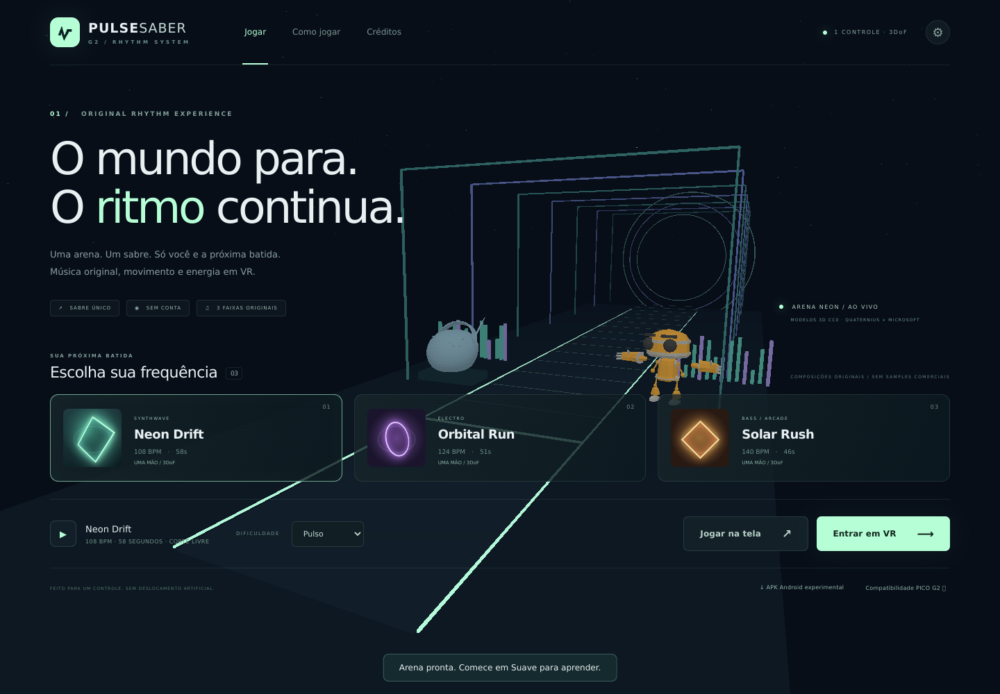
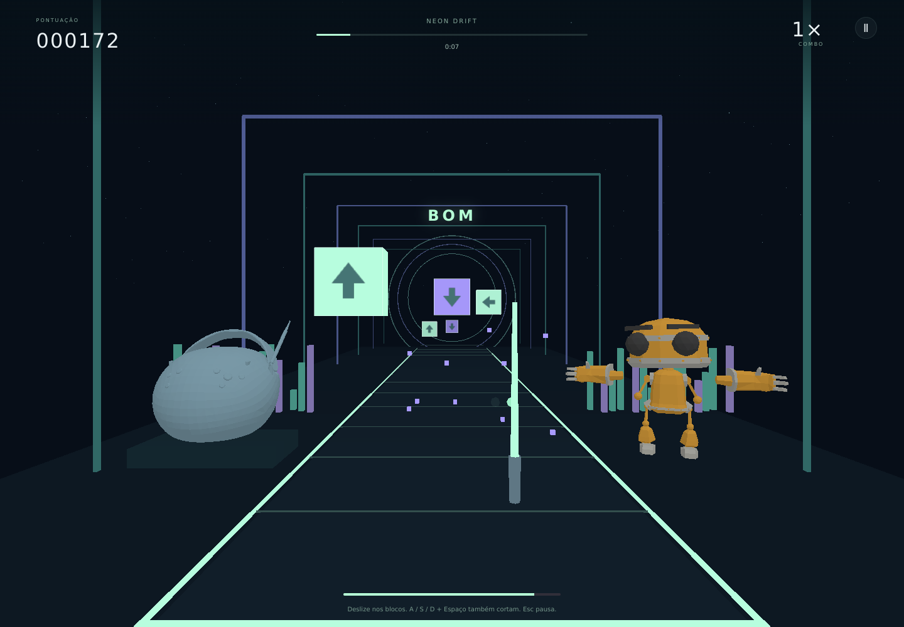

# Pulse Saber G2

**Jogo de ritmo original para um controle**, inspirado no gênero de corte musical — não é Beat Saber, não copia seu código, músicas, modelos, logotipo ou mapas. Sem afiliação à Beat Games, Meta ou PICO.

**[Jogar no GitHub Pages](https://freestylesjoaoemiguel-max.github.io/GAMES-IN-PICOG2/pulse-saber-g2/)** · **[APK direto](https://freestylesjoaoemiguel-max.github.io/GAMES-IN-PICOG2/pulse-saber-g2/downloads/Pulse-Saber-G2.apk)** · **[WebXR ZIP](https://freestylesjoaoemiguel-max.github.io/GAMES-IN-PICOG2/pulse-saber-g2/downloads/Pulse-Saber-G2-WebXR.zip)**

Esses endereços são publicados pelo workflow `Deploy GitHub Pages` depois do merge na `main`. O PicoVerso continua na raiz e o Discord VR G2 na sua própria pasta.



## O que esta versão entrega

- **3 músicas próprias:** Neon Drift (108 BPM, 58s), Orbital Run (124 BPM, 51s), Solar Rush (140 BPM, 46s).
- **9 mapas:** Suave, Pulso e Intenso para cada faixa. Sem notas simultâneas que exijam duas mãos.
- Arena 3D, um sabre, blocos com setas, bombas no Intenso, partículas, feedback sonoro, energia, combo, multiplicador até 8×, precisão, ranking S–D, recordes locais, resultados e repetir.
- Corte livre assistido por padrão; corte direcional opcional, treino sem eliminação, LOW/MEDIUM/HIGH (MEDIUM padrão), volume, redução de movimento e offset ±200ms.
- Música e julgamento usam o relógio de áudio; pausa congela ambos. Ao perder foco, o jogo pausa.
- **Modelos externos reais:** RobotExpressive (Quaternius) e BoomBox (Microsoft), ambos **CC0**. Convertidos para decoração estática leve, com cores de vértice e geometria externa preservada. Não são modelos inventados ou downloads sem licença.
- **WebXR:** sessão `immersive-vr` real quando suportada; um controle via target ray, painel 3D de jogar/pausar/continuar/repetir/músicas/recentrar/sair.
- **APK nativo Java/OpenGL ES 2**, sem WebView, Unity, conta, Google Play Services, internet, câmera ou microfone. Música e modelos estão no APK e funcionam offline **se o app executar no aparelho**.

É uma primeira versão jogável com conteúdo próprio, **não a totalidade dos recursos ou catálogo de Beat Saber**. Não inclui editor de mapas, importação de músicas, multijogador ou campanha longa. Não há funções essenciais falsas ou respostas simuladas de uma integração externa.

## Limite importante: PICO G2 não foi testado

**Não há teste físico no G2, emulador Android ou sessão WebXR imersiva nesta entrega.** A compilação, assinatura e os testes de navegador não comprovam instalação, conforto, FPS ou controles no headset.

| Versão | O que ela usa | Limite |
|---|---|---|
| WebXR imersivo | Estéreo, pose da cabeça e raio do controle fornecidos pelo navegador/runtime | Requer HTTPS, WebGL2, módulos/import maps e WebXR; navegador antigo do G2 pode não suportar |
| Web na tela | WebGL2, mouse, toque ou teclado | Não é VR imersivo |
| APK nativo | Java, GLES2, MediaPlayer, eventos Android genéricos | **Monoscópico experimental, sem compositor/correção óptica/pose proprietária PICO** |

A posição virtual do sabre é obtida pela interseção do raio do controle com a área de corte. Isso permite orientação 3DoF sem inventar uma posição física 6DoF. Não se exige andar, agachar, pular ou esquivar fisicamente; bombas são evitadas não cortando.

O APK não marca uma view dupla como se fosse VR PICO. Para torná-lo um app VR nativo validado ainda é necessário SDK/runtime oficial compatível com G2, integração ao compositor/controle e testes no headset. Não foi embutido SDK proprietário de licença desconhecida. **Não posso garantir que tudo funcione no PICO G2 sem isso.**

## Passo a passo fácil

1. Abra **[Pulse Saber G2](https://freestylesjoaoemiguel-max.github.io/GAMES-IN-PICOG2/pulse-saber-g2/)** no navegador.
2. Escolha **Neon Drift**, dificuldade **Suave**.
3. Clique em **Jogar na tela** para conhecer a partida. O áudio começa após essa ação; nenhuma conta é necessária.
4. Quando os blocos chegarem à linha iluminada, deslize o mouse/dedo através deles.
5. Para o headset: abra o mesmo link no navegador do PICO e clique em **Entrar em VR**. Se o navegador autorizar a sessão, aponte para **JOGAR** no painel e aperte o gatilho.
6. Se aparecer que WebXR não está disponível, isso é falta de suporte do navegador/runtime, não uma partida VR iniciada. Use o modo de tela em navegador compatível. Instalar o APK não adiciona WebXR ao navegador antigo.
7. Para instalar o APK, baixe o **arquivo direto** acima. Alternativa ADB: `adb install -r Pulse-Saber-G2.apk`. A execução no G2 permanece experimental.

### Controles

| Entrada | Ação |
|---|---|
| Mouse/toque | Deslize através dos blocos; clique/toque parado corta somente no modo livre |
| Teclado web/Android | A/S/D selecionam coluna; Espaço corta a nota mais próxima dessa coluna, somente em modo livre |
| WebXR | Mova a orientação de um controle; o sabre segue o raio do runtime; gatilho seleciona botões ou corta no modo livre |
| Pausa web | Esc, botão Ⅱ ou painel/menu do controle quando o runtime entregar o botão |
| APK | Toque, direcional/joystick genérico move cursor; A/centro/R1/R2 corta se o firmware gerar esses eventos; BACK/MENU pausa |
| Recentrar WebXR | Aponte para CENTRAR no painel e aperte o gatilho |

Corte livre ignora a seta; desligue-o nos ajustes para corte direcional. Direção errada não pontua. Em Intenso, blocos âmbar girados são bombas; não toque. Vibração só é solicitada quando o runtime expõe atuador; não se presume que o G2 tenha vibração.

Use um espaço seguro e fones em volume confortável. Fones Bluetooth podem atrasar o som. Offset positivo atrasa as notas visuais em relação ao áudio; negativo adianta. Sem movimentos rápidos de câmera ou deslocamento artificial. Pare se houver desconforto.

## Código e execução local

Requisitos web: Node.js 22/npm; navegador moderno com WebGL2.

```bash
cd pulse-saber-g2
npm ci --ignore-scripts
npm start
# servidor 0.0.0.0:5175; abre http://localhost:5175 no computador
npm test
# servidor rodando:
npm run test:browser
npm run build
```

`build/webxr/` é um site independente, com Three.js e assets locais; hospede por HTTPS na raiz ou em uma subpasta. Não abra por `file://`. Nenhuma dependência de CDN, conta, backend ou API de músicas.

### APK real

Package: `com.picog2.pulsesaber`, versão 1.0.0/code1, min Android 23, target 28, GLES2. Não usa bibliotecas nativas específicas de CPU. O target antigo é para desenvolvimento/sideload legado, não aprovação para lojas atuais.

```bash
# raiz do repositório, Linux x86_64:
bash pulse-saber-g2/tools/bootstrap_android.sh
# tools já disponíveis:
.venv/bin/python pulse-saber-g2/tools/build_android.py
```

Saída: `pulse-saber-g2/web/downloads/Pulse-Saber-G2.apk`, checksum e `docs/ANDROID_BUILD.txt`. Compilação ECJ → D8 → AAPT2 → apksigner; assinatura v1/v2/v3 verificada, manifest/DEX/assets/ZIP inspecionados. O bootstrap compartilha ferramentas fixadas com Discord VR G2, não código do cliente Discord. Veja [TOOLCHAIN](docs/TOOLCHAIN.md).

Cada ambiente CI sem chave própria gera uma **chave de desenvolvimento nova**. Builds assinadas por chaves diferentes não atualizam por `adb install -r`; uma desinstalação apaga recordes/configurações. Não desinstale sem aceitar essa perda. Uma release estável precisa de keystore privada estável, fornecida por `SIGNING_KEYSTORE`, `SIGNING_PASSWORD_FILE` e `SIGNING_ALIAS`; nunca coloque segredo em Git. As chaves não são publicadas nos artefatos.

## GitHub: build e publicação

- **Pulse Saber G2 - APK and WebXR:** testa regras/assets, compila o APK no runner, gera WebXR e executa testes reais de navegador antes de publicar artefatos.
- **Deploy GitHub Pages:** na `main`, compila os APKs e publica o site existente + `/discord-vr-g2/` + `/pulse-saber-g2/`, sem substituir os outros jogos. O APK no link direto é compilado **nessa execução do GitHub**, não apenas um arquivo enviado manualmente.
- O APK legacy do PicoVerso tem workflow separado, restrito à `main` para não substituir sua Release a partir desta branch de desenvolvimento.
- Artefatos Actions duram 30 dias e podem exigir login; os downloads do Pages não exigem login e duram enquanto o site continuar publicado.

## Assets, música e licenças

Veja [CREDITS.txt](web/CREDITS.txt), [hashes/fontes dos modelos](docs/ASSETS.json) e os avisos upstream em `docs/`. Fontes de terceiros são fixadas por commit; direitos não são inferidos da mera disponibilidade online.

Os GLBs originais ficam em `.cache/pulse-models`, não são redistribuídos completos. O script `tools/prepare_models.py` transforma a geometria legalmente obtida em `xyzrgb-triangles-v1`, usado em **ambas** as versões. São props estáticos, não personagens animados por um esqueleto.

`tools/compose_music.py` gera as faixas, percussão, arpejos e mapas de maneira determinística. Nenhuma música comercial foi baixada. Para regenerar música/modelos é preciso NumPy 2.2.6 (`.venv/bin/pip install numpy==2.2.6`); as builds CI usam os assets já versionados e validados.

## Testes e performance

- **15 testes Node:** corte varrido, tempo, direção, bomba, miss, pausa, treino, rank, clamps, mapas e hashes dos modelos, formato/duração do áudio.
- **12 verificações Chromium:** carrega os dois modelos, seleciona faixas, persiste ajustes, pontua com relógio real de áudio, corta por raycast real do mouse, pausa/retoma, perde energia, gera resultados, repete, informa falta de WebXR, verifica bytes do APK e layout mobile.
- APK compilado e assinado de verdade. **Não testado:** instalação/execução Android, aparelho G2, VR imersivo, pose original, conforto, latência de áudio ou temperatura.
- Sem sombras, bloom, física pesada ou luzes dinâmicas. Modelos juntos: 9.273 triângulos. Meshes de notas reutilizados, até 80 partículas web/60 Android, áudio mono 22.050Hz. Render web não imersivo: 30 FPS LOW / até 60 nas demais; WebXR segue o runtime. Android mira 30/45/60 por perfil, sem promessa de FPS medido.
- No teste desktop observado, ~115 draw calls; **não é benchmark de desempenho no G2**. Se houver travamento, use LOW/redução de efeitos e registre o modelo/firmware/navegador.



Relatórios: [Android](docs/ANDROID_BUILD.txt) · [Node](docs/NODE_TESTS.txt) · [Navegador](docs/BROWSER_TESTS.json).
