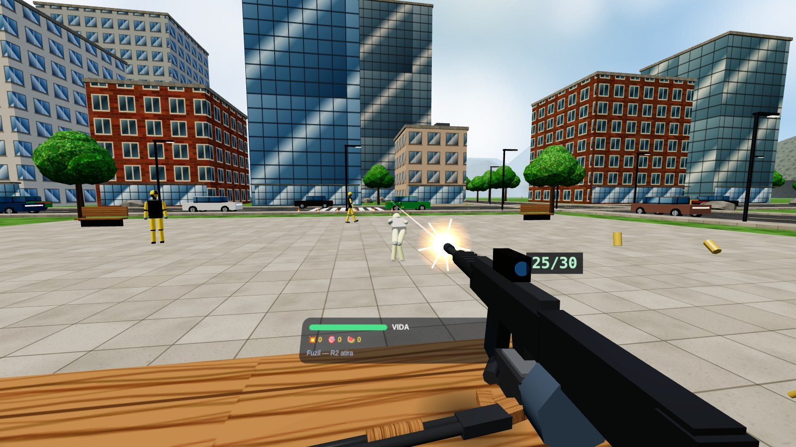
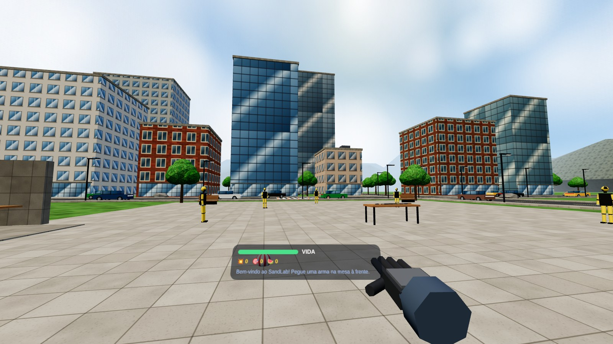
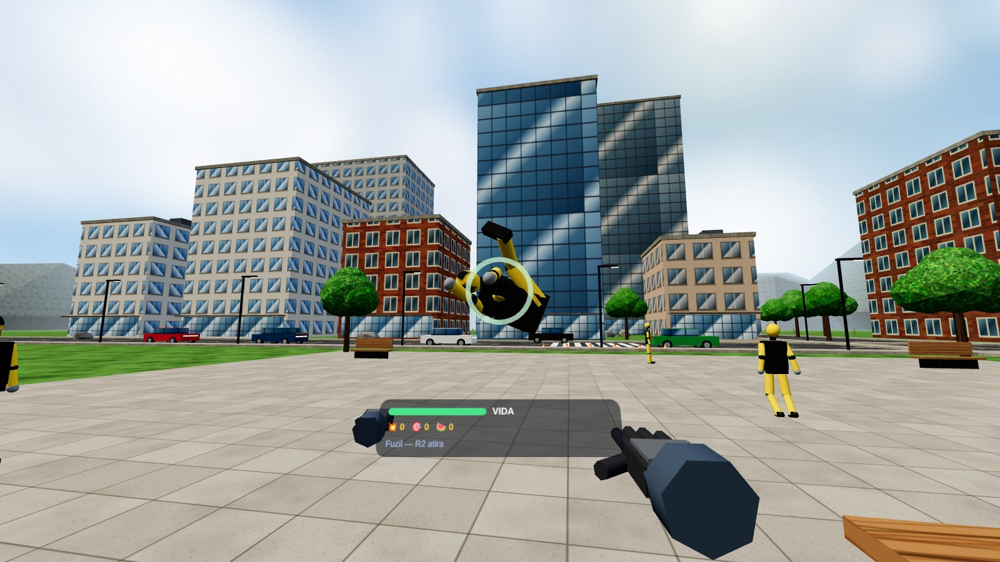
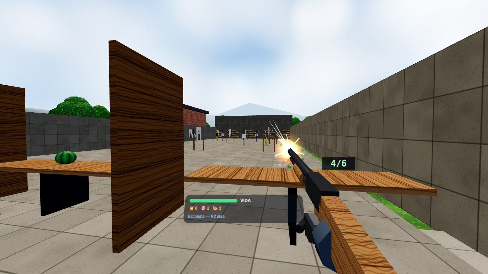
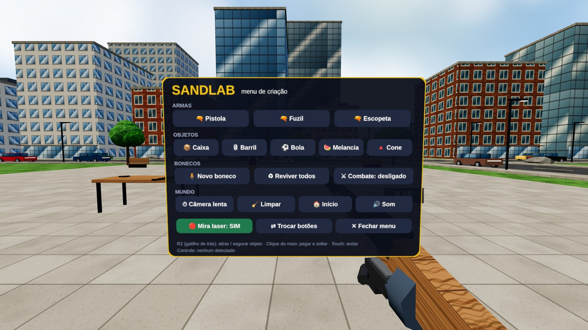

# SandLab VR — sandbox de mundo aberto para Pico G2

Sandbox em VR no estilo dos jogos de física: cidade aberta, armas, objetos com física e **bonecos de teste de impacto com ragdoll** que levam tiro, caem, podem ser agarrados e arremessados, e se levantam de novo.

| | |
|---|---|
|  |  |
|  |  |

*Capturas reais do jogo (renderizadas no navegador pelo próprio código do jogo).*

## Jogar
* **WebXR (navegador do Pico → “Entrar em VR”):** https://freestylesjoaoemiguel-max.github.io/GAMES-IN-PICOG2/sandlab/
* **APK:** [SandLab-VR.apk](https://github.com/freestylesjoaoemiguel-max/GAMES-IN-PICOG2/releases/download/sandlab-latest/SandLab-VR.apk) (`adb install SandLab-VR.apk`; o APK usa o modo giroscópio, sem WebXR)

## Controles (Pico G2)
| Ação | Botão |
|---|---|
| Atirar | **R2** (gatilho de trás) |
| Pegar / soltar arma ou objeto | **Clique do meio** (touch) — aponte e o item voa para a mão |
| Segurar e arremessar objeto/boneco | Segure o **R2** apontando para ele; solte para arremessar |
| Andar | Deslize o **touch** para frente/trás/lados (empurrar até o fim = correr) |
| Menu de criação | Segure o **clique do meio** ~1 s (com a mão vazia) |
| Recarregar | Automático quando o pente acaba |

No menu: criar armas (pistola, fuzil automático, escopeta), objetos (caixa, barril, bola, melancia, cone) e bonecos; reviver bonecos; **modo combate** (os bonecos vêm te atacar); **câmera lenta**; mira laser; trocar os botões se o seu controle vier invertido.

No PC: WASD anda · mouse mira · clique esquerdo = R2 · clique direito ou **E** = pegar/soltar · **Q** menu · **R** recarregar · **Shift** corre.

## Mundo
Praça central com mesa de armas · ruas com faixas, calçadas e carros · prédios (fachada, tijolo, torres de vidro) · armazém e contêineres · estande de tiro com alvos de papel e placas de aço · parquinho de física com pirâmide de caixas · parque com árvores · montanhas e céu 360°.

## Desempenho
O cenário é fundido por material (≈ 66 draw calls e ≈ 45 mil triângulos na vista da praça), as texturas são geradas no código e cada boneco é uma única malha atualizada por quadro. Não foi possível medir o FPS num Pico G2 físico.
